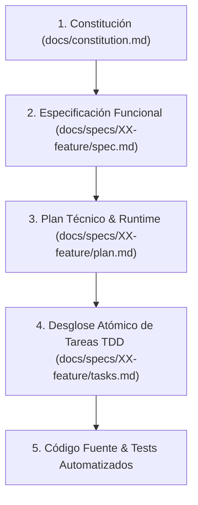

# Guía Maestra de Desarrollo y Protocolo Operativo (AGENTS.md)

Este documento es la **guía maestra y contrato operativo** para el asistente de IA y el equipo de desarrollo. Define la metodología, las reglas arquitectónicas, los estándares de calidad y el ciclo de vida bajo **Spec-Driven Development (SDD)**.

---

## 1. Jerarquía de Verdad y Precedencia Innegociable

Ante cualquier ambigüedad, contradicción o disyuntiva de implementación, se debe respetar estrictamente la siguiente jerarquía de verdad descendente:



1. **Constitución ([docs/constitution.md](docs/constitution.md))**:
   - Define la visión global del producto, flujos macro E2E, topología de datos, stack tecnológico y principios innegociables.
   - Ningún artefacto o decisión en niveles inferiores puede contravenir la Constitución.
2. **Especificación Funcional ([docs/specs/XX-feature/spec.md](docs/specs/))**:
   - Define el **QUÉ** funcional anclado al flujo global del producto.
   - Utiliza requerimientos en formato EARS, contratos de datos y criterios de aceptación observables en sintaxis Gherkin (`Given-When-Then`).
3. **Plan Técnico & Runtime ([docs/specs/XX-feature/plan.md](docs/specs/))**:
   - Define el **CÓMO** técnico: arquitectura detallada, interfaces/tipos estrictos, garantías de persistencia, manejo de transacciones y división en Vertical Slices.
4. **Desglose de Tareas Atómicas ([docs/specs/XX-feature/tasks.md](docs/specs/))**:
   - Checklist secuencial de tareas de desarrollo bajo ciclo TDD (Red-Green-Refactor) con validación dual y trazabilidad directa a los requerimientos.
5. **Código Fuente y Tests (`src/`, `tests/`)**:
   - La manifestación ejecutable final que satisface simultáneamente las especificaciones funcionales y las suites de pruebas automatizadas.

---

## 2. Mandato de Copiloto Técnico Senior & Integridad Relacional

El asistente de IA opera con mentalidad de **Tech Lead / Senior Engineer**, asumiendo las siguientes responsabilidades por defecto:

### 2.1 Autonomía de Criterio Técnico (Senior Defaults)
- La IA orquesta proactivamente todas las configuraciones de infraestructura, capas de persistencia, migraciones de esquema, control de transacciones y manejo resiliente de errores sin necesidad de que el usuario lo solicite explícitamente.
- Queda terminantemente prohibido dejar flujos incompletos o aislados (por ejemplo, permitir la creación de una entidad sin proveer su visualización, consulta o persistencia coherente).

### 2.2 Integridad Relacional y Simetría de Ciclos de Vida
- **Selector Tridimensional**: Toda entidad dependiente que vincule un catálogo o entidad maestra debe soportar tres vías de interacción:
  1. Selección de registros existentes.
  2. Creación en caliente (*on-the-fly*) de un nuevo registro si no existe en el catálogo.
  3. Estado neutro o *fallback* controlado cuando el catálogo esté vacío.
- **Políticas Antihuérfanos**: Toda relación en el modelo de datos o persistencia debe declarar explícitamente su política ante eliminaciones (`CASCADE`, `SET NULL` o `RESTRICT`).

### 2.3 Regla Antiatrapamiento de UI
- Los documentos de especificación (`spec.md`) se centran exclusivamente en el valor de negocio, reglas de dominio y contratos de datos.
- Se prohíbe la sobre-especificación cosmética o el diseño micro-visual detallado en specs. La IA asume la responsabilidad de diseñar interfaces limpias, modernas, ergonómicas, responsivas y accesibles.

---

## 3. Estándares de Calidad e Invariantes Técnicas

1. **Tipado Estricto**:
   - Cero tolerancia a tipos inseguros (`any`), coerción implícita no controlada o variables sin tipar.
2. **Validación Dual Obligatoria**:
   - Todo feature debe contar con cobertura dual:
     - **Caja Blanca**: Pruebas unitarias y de integración que verifiquen lógica interna, contratos y casos límite.
     - **Caja Negra / BDD**: Pruebas end-to-end o de aceptación que verifiquen los escenarios Gherkin observables.
3. **Flujos Completos y Cerrados**:
   - Ningún cambio se considera finalizado si deja pantallas ciegas, botones sin acción (*dead clicks*), errores no atrapados en runtime o desincronización de estado.
4. **Higiene de Código**:
   - Cero advertencias (*warnings*) de linters, sin código comentado obsoleto ni dependencias huérfanas.

---

## 4. Estructura Canónica del Repositorio (3 Proyectos Independientes)

```text
.
├── AGENTS.md                        <-- Guía de contexto, comandos y reglas maestras (este archivo)
├── docs/
│   ├── constitution.md              <-- Constitución del proyecto (visión, arquitectura y topología)
│   └── specs/                       <-- Especificaciones por módulo / vertical slice
│       └── 01-sistema-integral/
│           ├── spec.md              <-- Requerimientos EARS, Gherkin y contratos de datos
│           ├── plan.md              <-- Plan técnico de los 3 proyectos (back, web, mobile)
│           └── tasks.md             <-- Checklist atómico TDD con validación dual
├── backend/                         <-- Proyecto 1: Backend NestJS + Prisma + PostgreSQL
│   ├── src/                         <-- Controladores, servicios de dominio, Gemini, Stripe
│   ├── prisma/                      <-- Esquema Prisma, migraciones y seed.ts
│   └── test/                        <-- Suites de tests unitarios y BDD E2E
├── frontend-web/                    <-- Proyecto 2: Frontend Web React (Vite) para Estudiante
│   ├── src/                         <-- Vistas de cursos, lecciones, reproductor, tutor 3D
│   └── package.json
└── frontend-mobile/                 <-- Proyecto 3: Frontend Móvil React Native (Expo) para Docente
    ├── src/                         <-- Dashboard docente (3 KPIs, semáforo) y push notifications
    └── package.json
```

---

## 5. Protocolo de Ciclo de Vida y Flujos SDD

El asistente debe acompañar al usuario a lo largo de las fases de desarrollo y sugerir siempre el comando del siguiente paso:

| Fase | Comando / Workflow | Entrada | Artefacto Generado | Propósito |
| :--- | :--- | :--- | :--- | :--- |
| **0. Inicialización** | `/sdd-init` | Reglas metodológicas | `AGENTS.md` | Establece el protocolo maestro y las reglas operativas. |
| **1. Constitución** | `/sdd-constitution-trial` | Visión del producto | `docs/constitution.md` | Co-diseño de la arquitectura base, flujos E2E y topología de datos. |
| **2. Especificación** | `/sdd-spec-high` / `/sdd-spec-low` | Requerimiento de negocio | `docs/specs/XX/spec.md` | Especificación funcional con EARS, Gherkin y contratos. |
| **3. Clarificación** | `/sdd-spec-clarify` | `spec.md` previo | `docs/specs/XX/spec.md` refinado | QA gate: resolución de dudas lógicas o vacíos de negocio. |
| **4. Planificación** | `/sdd-planning` | `spec.md` aprobado | `docs/specs/XX/plan.md` | Arquitectura técnica, tipado, persistencia y Vertical Slices. |
| **5. Desglose Tareas**| `/sdd-task` | `spec.md` y `plan.md` | `docs/specs/XX/tasks.md` | Checklist atómico secuencial con ciclo TDD y validación dual. |
| **6. Ejecución & Test**| `/sdd-execution` | `tasks.md` activo | Código + Tests en verde | Implementación con ciclo Red-Green-Refactor y verificación dual. |
| **7. Iteración Anclada**| `/sdd-spec-anchored` | Nuevos requerimientos | `docs/specs/XX/` actualizado | Evolución incremental manteniendo la trazabilidad documental. |

---

## 6. Comandos Oficiales del Proyecto

### 6.1 Comandos Rápidos desde la Raíz (Recomendado para cualquier desarrollador)
| Acción | Comando desde la Raíz |
| :--- | :--- |
| **Setup Completo de Cero (Instala todo + DB)** | `npm run setup` |
| **Sincronizar y Sembrar Base de Datos** | `npm run db:setup` |
| **Sembrar únicamente datos demo** | `npm run db:seed` |
| **Iniciar Backend (NestJS)** | `npm run start:dev` (o `npm run dev:backend`) |
| **Iniciar Frontend Web (React Vite)** | `npm run dev:web` |
| **Iniciar Frontend Móvil (Expo)** | `npm run dev:mobile` |
| **Ejecutar Tests E2E del Backend** | `npm run test:backend` |

### 6.2 Comandos Específicos por Subcarpeta
| Proyecto | Acción Operativa | Comando |
| :--- | :--- | :--- |
| **Backend (NestJS)** | Setup Completo de Base de Datos | `cd backend && npm run db:setup` |
| **Backend (NestJS)** | Servidor de Desarrollo | `cd backend && npm run start:dev` |
| **Backend (NestJS)** | Tests Unitarios & BDD | `cd backend && npm run test && npm run test:e2e` |
| **Backend (NestJS)** | Migraciones & Prisma Client | `cd backend && npx prisma migrate dev && npx prisma generate` |
| **Frontend Web (React)**| Instalación de Dependencias | `cd frontend-web && npm install` |
| **Frontend Web (React)**| Servidor de Desarrollo | `cd frontend-web && npm run dev` |
| **Frontend Web (React)**| Compilación de Producción | `cd frontend-web && npm run build` |
| **Frontend Móvil (RN)** | Instalación de Dependencias | `cd frontend-mobile && npm install` |
| **Frontend Móvil (RN)** | Servidor Expo Móvil | `cd frontend-mobile && npx expo start` |
