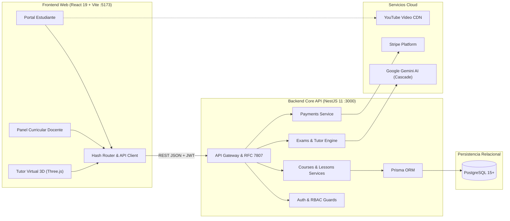

# Arquitectura Integral del Sistema (Archify Diagram)

Este directorio contiene el proyecto y artefacto de visualización arquitectónica interactiva generado con **Archify (v3.0)**, modelando la interacción de extremo a extremo entre el **Frontend Web (`frontend-web/`)**, el **Backend API (`backend/`)** y las plataformas en la nube.

---

## 📁 Archivos del Proyecto

| Archivo | Descripción |
| :--- | :--- |
| **[`system-architecture.html`](system-architecture.html)** | Diagrama interactivo autocontenido en HTML con gráficos vectoriales SVG, selector de tema oscuro/claro, zoom, paneo interactivo y exportación a PNG/SVG/WebP. |
| **[`system-architecture.json`](system-architecture.json)** | Definición declarativa y fuertemente tipada de la topología, componentes, límites de seguridad (*boundaries*), conexiones y tarjetas informativas. |

---

## 🖥️ ¿Cómo Ver el Diagrama Interactivo?

Puedes abrir directamente el archivo en cualquier navegador moderno:

1. **Desde tu explorador de archivos**:
   Haz doble clic sobre:
   ```text
   docs/architecture/system-architecture.html
   ```
2. **O desde la terminal**:
   ```bash
   start docs/architecture/system-architecture.html
   ```

---

## 🛠️ Comandos de Archify para Mantenimiento

Para regenerar, validar o inspeccionar el diagrama:

```bash
# 1. Compilar y renderizar el JSON hacia HTML interactivo
node .agents/skills/archify/bin/archify.mjs render architecture docs/architecture/system-architecture.json docs/architecture/system-architecture.html

# 2. Validar calidad de layout y clearance de etiquetas
node .agents/skills/archify/bin/archify.mjs check docs/architecture/system-architecture.html --json

# 3. Previsualizar con servidor local integrado
node .agents/skills/archify/bin/archify.mjs preview architecture docs/architecture/system-architecture.json docs/architecture/system-architecture.html
```

---

## 🏛️ Topología Representada en el Diagrama


