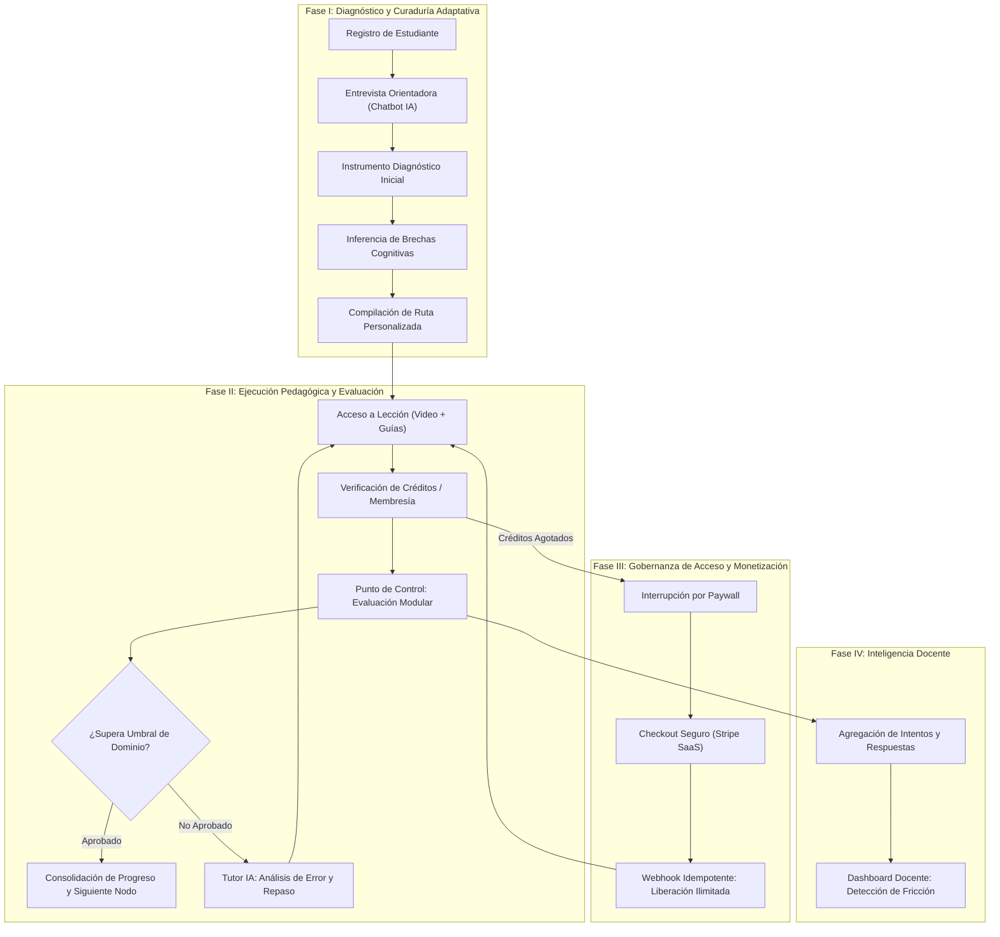

# Constitución del Proyecto: Adaptive LMS & AI Pedagogical Ecosystem

> Versión: 1.1.0 | Estado: Activa y Vinculante | Metodología: SDD-Constitution

---

## 1. Misión, Filosofía de Dominio y Alcance Conceptual

### 1.1 Tesis y Propósito Central
El proyecto concibe un **Ecosistema de Aprendizaje Adaptativo e Inteligente (Adaptive LMS)** cuyo paradigma central es la **personalización dinámica de la enseñanza**. A diferencia de los repositorios tradicionales de video bajo demanda, el sistema opera como un **tutor pedagógico algorítmico** que ajusta la trayectoria formativa de cada estudiante en función de su nivel cognitivo real, sus metas formativas y sus patrones de error.

El sistema se fundamenta en cinco pilares conceptuales:
1. **Diagnóstico Adaptativo Guiado por IA**: El aprendizaje no inicia de forma lineal y estática; comienza con un diálogo de orientación y una preevaluación diagnóstica que detecta fortalezas y brechas conceptuales para generar una **Ruta de Aprendizaje Personalizada**.
2. **Jerarquía Curricular y Consumo Eficiente**: Organización estructurada de conocimientos en **Cursos $\to$ Módulos $\to$ Lecciones**, combinando distribución ligera de video (mediante streaming desacoplado en YouTube) y recursos educativos complementarios.
3. **Evaluación Formativa y Analítica de Dificultad**: Sistema continuo de evaluación diagnóstica, modular y final que no solo califica, sino que analiza cualitativamente las causas de error y alimenta tableros de inteligencia pedagógica para el docente.
4. **Interacción Multimodal Humanizada (Tutor Digital)**: Capa conversacional y de síntesis interactiva (voz, texto y metadatos de sincronización gestual para clientes 3D) que proporciona soporte explicativo contextualizado a cada lección.
5. **Sostenibilidad del Modelo de Negocio (Freemium & SaaS)**: Mecanismo de acceso condicionado mediante balance de créditos promocionales y transición fluida a suscripciones recurrentes procesadas mediante pasarelas de pago estándar en la industria.

### 1.2 Topología de Actores y Roles
- **Estudiante (Learner)**: Sujeto central del proceso formativo. Experimenta una interfaz adaptativa que diagnostica sus conocimientos, consume lecciones curadas, evalúa su progreso y recibe retroalimentación correctiva en tiempo real.
- **Docente (Educator / Content Creator)**: Diseñador instruccional y curador pedagógico. Publica estructuras curriculares, gestiona bancos de reactivos y monitorea el mapa de calor de dificultades de sus alumnos para optimizar los contenidos.
- **Administrador (System Operator)**: Custodio de la plataforma. Gobierna la asignación de privilegios, audita el flujo financiero de suscripciones y garantiza la observabilidad e integridad del ecosistema.

### 1.3 Vocabulario Ubicuo (Domain Model Terminology)
- **Ruta de Aprendizaje (`LearningPath`)**: Grafo dirigido acíclico (DAG) o secuencia ordenada de módulos y lecciones calculada heurísticamente o por modelos de lenguaje en base al perfil del estudiante.
- **Evaluación Diagnóstica (`DiagnosticAssessment`)**: Instrumento calibrado para medir el estado inicial del estudiante respecto a un dominio de conocimiento.
- **Reactivo / Pregunta (`Question`)**: Unidad atómica de evaluación con ponderación, opciones de respuesta y retroalimentación pedagógica asociada.
- **Intento Evaluativo (`ExamAttempt`)**: Registro inmutable de la ejecución de una prueba por parte de un estudiante, incluyendo respuestas, tiempo, calificación y análisis sintético generado por IA.
- **Libro de Créditos (`CreditLedger`)**: Registro auditable de unidades de valor que facultan el consumo de servicios computacionales (tutoría IA, corrección avanzada) y acceso a lecciones premium.
- **Suscripción Recurrente (`SubscriptionPlan`)**: Contrato temporal de acceso irrestricto vinculado al estado transaccional en la pasarela de pagos.

### 1.4 Límites y Fronteras del Sistema (Out of Scope)
- **Codificación y Almacenamiento Pesado de Video**: El sistema delega la transcodificación y entrega masiva de video a proveedores especializados (YouTube); el backend gestiona metadatos y validaciones de acceso.
- **Acoplamiento Monolítico de Clientes**: La plataforma se construye estrictamente bajo el paradigma de **Backend API-First**. Los clientes web y móviles consumen la API de forma independiente; el repositorio actual formaliza y garantiza el cerebro de datos y servicios.

---

## 2. Flujo de Valor Global y Ciclo de Vida E2E

### Recorridos Sistémicos Críticos

1. **Jornada de Inmersión y Diagnóstico (Onboarding Adaptativo)**:
   - Captura de identidad $\to$ Exploración conversacional de metas $\to$ Ejecución de reactivos de nivel $\to$ Resolución de grafo de contenidos recomendados.
2. **Jornada de Consumo y Validación de Conocimiento**:
   - Navegación secuencial de lecciones $\to$ Registro atómico de avance $\to$ Rendición de examen $\to$ Evaluación asistida por IA con sugerencia de temas de refuerzo específicos.
3. **Jornada de Conversión y Facturación Recurrente**:
   - Cuota de bienvenida (3 créditos freemium) $\to$ Débito por interacción de alto valor $\to$ Activación de paywall ante balance nulo $\to$ Liquidación en pasarela $\to$ Transición a cuenta ilimitada.
4. **Jornada de Optimización Curricular del Docente**:
   - Alta de contenidos y reactivos $\to$ Visualización de tasas de fallo por pregunta/módulo $\to$ Refinamiento de material educativo.

---

## 3. Arquitectura de Software, Stack y Validación Dual

### 3.1 Decisiones Arquitectónicas del Backend
- **Framework y Plataforma**: **NestJS 10+** sobre Node.js LTS, implementando principios de diseño modular, separación estricta de capas (Controladores, Servicios de Aplicación, Repositorios) y desacoplamiento de infraestructura.
- **Persistencia Relacional**: **PostgreSQL 15+** orquestado mediante **Prisma ORM**, garantizando tipado estricto extremo de extremo a extremo, prevención de desalineaciones de esquema y migraciones declarativas reproducibles.
- **Capa de Inteligencia Artificial**: Integración desacoplada con **Google Gemini API** mediante servicios especializados con contratos de reintentos y degradación elegante.
- **Capa de Transacciones Financieras**: Integración con **Stripe API** para la creación de sesiones de pago hospedadas y procesamiento seguro de eventos vía webhooks firmados.
- **Validación y Contratos**: DTOs universales con `class-validator` y `class-transformer`; documentación viva bajo OpenAPI / Swagger.

### 3.2 Invariante de Validación Dual (Testing Strategy)
Ningún componente de software se considera terminado sin satisfacer simultáneamente:
1. **Caja Blanca (Structural Unit Tests)**:
   - Cobertura exhaustiva de lógica de dominio pura: cálculo de balances de créditos, transiciones de estado de ruta de aprendizaje, reglas de aprobación de exámenes y evaluación de respuestas.
   - Ejecución veloz y aislada de dependencias externas mediante inyección de mocks.
2. **Caja Negra (Behavior-Driven / Integration Tests)**:
   - Pruebas sobre la interfaz HTTP real (Supertest) que verifican el cumplimiento observable de los escenarios Gherkin (`Given-When-Then`), validando códigos de respuesta, headers de seguridad y mutaciones en base de datos.

---

## 4. Topología de Persistencia y Gobernanza Relacional

### 4.1 Principios de Modelado de Datos
- **Consistencia Transaccional**: Toda operación que altere estados compartidos (por ejemplo: finalizar examen, decrementar crédito y certificar módulo) debe encapsularse en una transacción atómica (`prisma.$transaction`).
- **Políticas Antihuérfanos Obligatorias**:
  - `CASCADE`: Jerarquías compuestas indisolubles (`Course -> Module -> Lesson`, `Exam -> Question -> Option`, `ChatSession -> ChatMessage`).
  - `RESTRICT`: Entidades con implicaciones fiscales, históricas o académicas (`User -> Subscription`, `Course -> Enrollment`, `User -> ExamAttempt`).
  - `SET NULL`: Atribuciones de modificación y auditoría.
- **Integridad del Selector Tridimensional**: La vinculación de entidades maestras (categorías, prerrequisitos, exámenes modelo) debe soportar en todo momento:
  1. Conexión a elemento existente.
  2. Aprovisionamiento en caliente (*on-the-fly*).
  3. Comportamiento resiliente y controlado ante colecciones vacías.

---

## 5. Resiliencia, Conectividad y Políticas Operativas

1. **Gestión de Cuotas y Límites de APIs Externas**:
   - Las consultas hacia servicios de IA deben implementar políticas de reintentos con retraso exponencial (Exponential Backoff).
   - En situaciones de indisponibilidad o saturación de cuota, el backend debe activar un modo heurístico de contingencia garantizando que el usuario no quede bloqueado.
2. **Idempotencia en Pagos y Webhooks**:
   - Registro inmutable de eventos procesados para impedir la duplicación de créditos o suscripciones ante reenvíos de la pasarela.
3. **Optimización para Clientes Desconectados (Mobile-Ready)**:
   - Endpoints diseñados para recibir sincronizaciones por lotes de progreso (`sync-batch`) acumuladas por dispositivos móviles en modalidad offline.

---

## 6. Calidad de Código e Invariantes Técnicas

1. **Tipado Estricto Absoluto**: Prohibido el uso de `any`, conversiones no seguras o variables implícitas.
2. **Arquitectura Sin Puntos Ciegos**: Ningún flujo puede carecer de consulta, persistencia y visualización coherente.
3. **Manejo Estandarizado de Errores**: Respuestas de error uniformes basadas en el estándar RFC 7807 (Problem Details).
4. **Higiene del Repositorio**: Código libre de advertencias de linter, comentarios obsoletos o dependencias no utilizadas.

---

## 7. Comandos Operativos del Proyecto

| Acción | Comando |
| :--- | :--- |
| **Instalación de Dependencias** | `npm install` |
| **Servidor de Desarrollo** | `npm run start:dev` |
| **Compilación de Producción** | `npm run build` |
| **Pruebas Unitarias (Caja Blanca)** | `npm run test` |
| **Pruebas BDD / Integración (Caja Negra)** | `npm run test:e2e` |
| **Verificación de Tipos y Linter** | `npm run lint` |
| **Generación de Cliente Prisma** | `npx prisma generate` |
| **Migraciones de Base de Datos** | `npx prisma migrate dev` |
| **Explorador Visual de Datos** | `npx prisma studio` |
