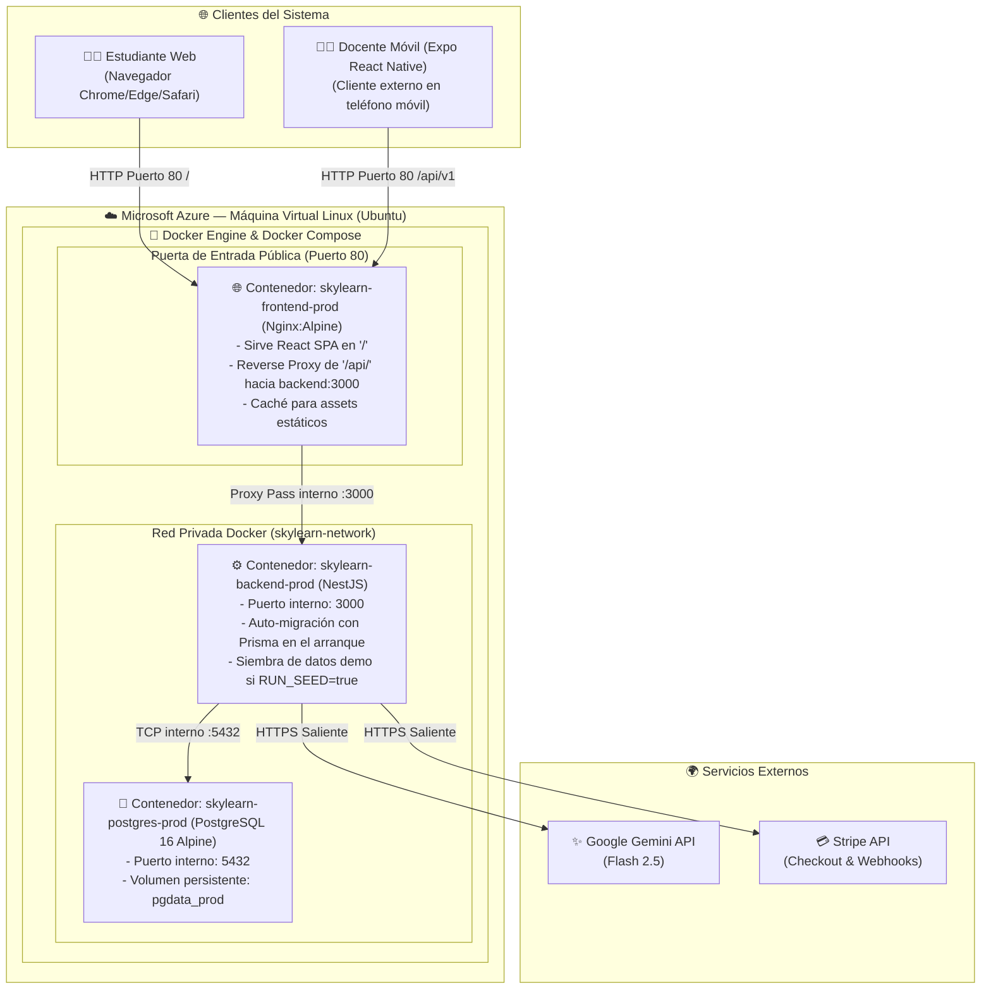

# 📘 00: Resumen General y Arquitectura de Despliegue en Microsoft Azure con Docker Integral

> **Entorno:** Producción Cloud  
> **Proveedor Cloud:** Microsoft Azure (Optimizado para Suscripción con $200 USD de Crédito)  
> **Estrategia de Despliegue:** Stack Dockerizado Integral orquestado con Docker Compose (`PostgreSQL` + `Backend NestJS` + `Frontend Web Nginx`) en Máquina Virtual Linux  
> **Proyecto:** Skylearn — Tutor Virtual Adaptativo 3D  
> **Stack de Servidor:** NestJS + Prisma ORM + PostgreSQL 16 (Docker) + React (Vite / Nginx)  
> **Cliente Móvil (`frontend-mobile`):** Cliente externo desacoplado (Expo React Native), ejecutado localmente en dispositivos móviles que consume la API REST vía HTTP en el puerto 80  

---

## 🗺️ Mapa de Navegación Rápida
- **[00_RESUMEN_GENERAL.md](file:///c:/EDBERTO/ULTIMO/SW1/PROYECTO%20FINAL/SW1-PF-TUTOR-VIRTUALvF-26-2/docs/deploy/00_RESUMEN_GENERAL.md)** ⬅️ *Usted está aquí*
- **[01_PASO_A_PASO_AZURE_PORTAL_INTERFAZ.md](file:///c:/EDBERTO/ULTIMO/SW1/PROYECTO%20FINAL/SW1-PF-TUTOR-VIRTUALvF-26-2/docs/deploy/01_PASO_A_PASO_AZURE_PORTAL_INTERFAZ.md)** ➡️ *Guía visual para principiantes: Crear VM en Azure Portal, clonar y levantar con 1 comando*
- **[02_CONFIGURAR_DOCKER_Y_PROYECTO.md](file:///c:/EDBERTO/ULTIMO/SW1/PROYECTO%20FINAL/SW1-PF-TUTOR-VIRTUALvF-26-2/docs/deploy/02_CONFIGURAR_DOCKER_Y_PROYECTO.md)** ➡️ *Dockerfiles, Nginx Reverse Proxy, variables de entorno y persistencia PostgreSQL*
- **[03_CREAR_INFRAESTRUCTURA_AZURE.md](file:///c:/EDBERTO/ULTIMO/SW1/PROYECTO%20FINAL/SW1-PF-TUTOR-VIRTUALvF-26-2/docs/deploy/03_CREAR_INFRAESTRUCTURA_AZURE.md)** ➡️ *Aprovisionamiento rápido con Azure CLI (`az vm create`)*
- **[04_INSTALAR_HERRAMIENTAS.md](file:///c:/EDBERTO/ULTIMO/SW1/PROYECTO%20FINAL/SW1-PF-TUTOR-VIRTUALvF-26-2/docs/deploy/04_INSTALAR_HERRAMIENTAS.md)** ➡️ *Instalación de Docker y Docker Compose en la VM con 1 comando*
- **[05_DESPLEGAR_Y_VERIFICAR.md](file:///c:/EDBERTO/ULTIMO/SW1/PROYECTO%20FINAL/SW1-PF-TUTOR-VIRTUALvF-26-2/docs/deploy/05_DESPLEGAR_Y_VERIFICAR.md)** ➡️ *Comando unificado de arranque, verificación de logs y pruebas E2E*
- **[06_ACTUALIZAR_PRODUCCION.md](file:///c:/EDBERTO/ULTIMO/SW1/PROYECTO%20FINAL/SW1-PF-TUTOR-VIRTUALvF-26-2/docs/deploy/06_ACTUALIZAR_PRODUCCION.md)** ➡️ *Actualización en caliente con `git pull` y rebuild de contenedores*
- **[07_APAGAR_Y_REACTIVAR.md](file:///c:/EDBERTO/ULTIMO/SW1/PROYECTO%20FINAL/SW1-PF-TUTOR-VIRTUALvF-26-2/docs/deploy/07_APAGAR_Y_REACTIVAR.md)** ➡️ *Estrategia de ahorro y detención de la VM para maximizar créditos ($200 USD)*
- **[08_FLUJO_VISUAL_DESPLIEGUE.html](file:///c:/EDBERTO/ULTIMO/SW1/PROYECTO%20FINAL/SW1-PF-TUTOR-VIRTUALvF-26-2/docs/deploy/08_FLUJO_VISUAL_DESPLIEGUE.html)** 🌐 *Dashboard Visual Interactivo*

---

## 1. Ficha Técnica del Sistema

| Parámetro | Detalle de Producción |
| :--- | :--- |
| **Nombre del Sistema** | Skylearn — Plataforma LMS Adaptativa con Tutor 3D y Analítica Docente |
| **Frontend Web** | React 19 + Vite 8 empaquetado en imagen Nginx Alpine. Actúa como **Reverse Proxy unificado** en el puerto 80 |
| **Backend API** | NestJS 11 empaquetado en contenedor Node.js 22 LTS Alpine con sincronización automática de esquema Prisma y seed demo |
| **Base de Datos** | PostgreSQL 16 Alpine en contenedor Docker con volumen local persistente (`pgdata_prod`) |
| **Orquestador** | Docker Compose v2 (`docker-compose.prod.yml`) con red bridge privada `skylearn-network` |
| **Infraestructura Cloud** | Azure Virtual Machine (Ubuntu 24.04 / 22.04 LTS, SKU `Standard_B2s` o `Standard_B1ms`) |
| **Puertos Públicos Abiertos** | Únicamente **Puerto 80 (HTTP)** y **Puerto 22 (SSH)**. PostgreSQL (5432) y Backend (3000) están aislados internamente |
| **Cliente Móvil (`frontend-mobile`)** | Cliente móvil externo que consume la API en `http://IP_SERVIDOR/api/v1` sin desplegarse en el servidor |
| **Suscripción de Azure** | Cuenta con $200 USD de créditos promocionales |
| **Región Recomendada** | `eastus` o `eastus2` |

---

## 2. Diagrama de Arquitectura de Contenedores en Azure

---

## 3. Estimación y Maximización del Crédito de $200 USD

Al unificar todo el stack (PostgreSQL, Backend y Frontend Web) en una sola Máquina Virtual con Docker, **el costo mensual se reduce drásticamente**, ya que no pagas servicios gestionados redundantes:

| Recurso en Azure | SKU / Tamaño | Costo Mensual Estimado | Cobertura con $200 USD |
| :--- | :--- | :--- | :--- |
| **Máquina Virtual Linux** | `Standard_B2s` (2 vCPU, 4 GiB RAM) | ~$24.80 USD / mes | **~8 meses continuo** |
| *(Opción ultra-económica)* | `Standard_B1ms` (1 vCPU, 2 GiB RAM) | ~$14.80 USD / mes | **~13.5 meses continuo** |
| **Disco SSD Administrado** | Disco OS SSD Estándar de 32 a 64 GB | ~$2.00 USD / mes | Incluido |
| **Total Mensual** | | **~$16.80 a $26.80 USD / mes** | **De 7.5 a 12+ meses** |

> [!TIP]
> Si apagas la máquina virtual cuando no la estés usando o fuera de horarios de prueba (como se explica en `07_APAGAR_Y_REACTIVAR.md`), el cómputo se pausa a **$0.00 USD/hora**, haciendo que tus $200 USD duren prácticamente todo el año académico.

