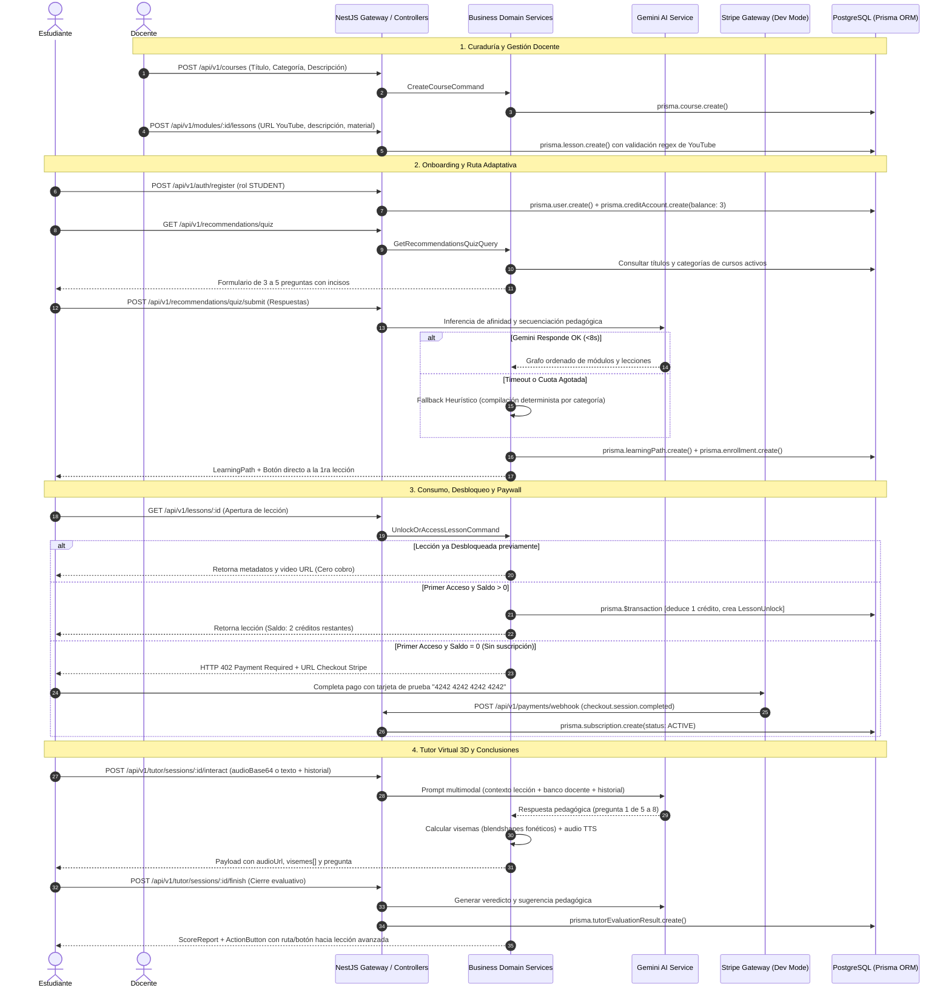

# Plan Técnico: Plataforma LMS Adaptativa e Inteligente

> Módulo: `docs/specs/01-sistema-integral/` | Especificación Base: `spec.md` | Estado: Aprobado y Diseñado | Metodología: SDD-Planning

---

## 1. Resumen Arquitectónico y Matriz de los 3 Proyectos Independientes

### 1.1 Objetivo Técnico del Ecosistema
Implementar un ecosistema desacoplado compuesto por **3 proyectos independientes** bajo un repositorio unificado:
1. **`backend/` (API REST Core)**: Servidor escalable y fuertemente tipado en **NestJS 10+**, **PostgreSQL 15+** y **Prisma ORM**, que centraliza la persistencia relacional, la orquestación con **Google Gemini API** (con fallback heurístico), la pasarela **Stripe Developer Mode** y los contratos JSON universales.
2. **`frontend-web/` (Aplicación Web del Estudiante)**: Cliente web reactivo en **React (Vite) + TypeScript**, implementando el sistema de diseño **Skylearn** (tipografía Atkinson Hyperlegible, Hubot Sans, Big Friendly Buttons, Answer Tiles), reproductor de YouTube, onboarding con cuestionario de recomendación, paywall de Stripe y **Avatar 3D interactivo con visemas** (Three.js / React Three Fiber).
3. **`frontend-mobile/` (Aplicación Móvil del Docente)**: Cliente móvil nativo en **React Native (Expo) + TypeScript** enfocado exclusivamente en el **Docente / Creador**, proveyendo el Dashboard de 3 KPIs, semáforo de cursos con lección crítica y recepción de **notificaciones push directas** ante nuevas inscripciones.

### 1.2 Topología de los 3 Proyectos Independientes

```
.
├── backend/                         # PROYECTO 1: Backend NestJS 10+
│   ├── src/
│   │   ├── common/                  # Filtros RFC 7807, PrismaService, GeminiService
│   │   └── modules/                 # auth, courses, lessons, recommendations, exams, tutor, payments, analytics
│   ├── prisma/                      # schema.prisma, migrations, seed.ts
│   └── test/                        # Suites de tests BDD con Supertest
│
├── frontend-web/                    # PROYECTO 2: React (Vite) - Cliente Estudiante
│   ├── src/
│   │   ├── components/skylearn/     # BigFriendlyButton, AnswerTile, StarBadge, ProgressBar
│   │   ├── components/avatar3d/     # Canvas 3D con Three.js y sincronización de visemas
│   │   ├── pages/                   # Onboarding, Quiz, Cursos, Lección (YouTube), Exámenes, Checkout
│   │   └── services/api.ts          # Cliente Axios tipado contra el backend
│   └── package.json
│
└── frontend-mobile/                 # PROYECTO 3: React Native (Expo) - Cliente Docente
    ├── src/
    │   ├── components/skylearn/     # Componentes móviles Skylearn (tarjetas, semáforos)
    │   ├── screens/                 # DashboardDocente (3 KPIs), DetalleCurso (lección crítica)
    │   └── services/notifications.ts# Registro de Expo Push Token y recepción de alertas
    └── package.json
```

### 1.3 Matriz de Responsabilidades por Proyecto
- **`backend/`**:
  - Exposición de endpoints RESTful seguros (`/api/v1/*`).
  - Autorización basada en roles (`STUDENT`, `TEACHER`, `ADMIN`).
  - Control de créditos freemium (balance inicial 3) y desbloqueo permanente.
  - Orquestación de IA con Gemini (timeout 8s + fallback determinista).
  - Webhooks de Stripe firmados con verificación criptográfica e idempotencia.
  - Despacho de notificaciones push directas a los dispositivos de los docentes.
- **`frontend-web/` (Estudiante y Gestión Curricular Docente)**:
  - Experiencia accesible K-8 con Skylearn y diseño dislexia-friendly.
  - Consumo de lecciones con reproductor embebido de YouTube y Answer Tiles para exámenes.
  - Interacción por voz (Web Speech / audioBase64) y texto con el Avatar 3D.
  - Flujo de checkout con Stripe Elements y tarjeta de prueba `4242 4242 4242 4242`.
  - **Gestión Docente en Web**: Creador y editor de cursos, módulos y lecciones con inputs para enlace de YouTube, variable de contexto del video y constructor dinámico de formularios evaluativos con opciones de respuesta y marcado de opción correcta.
- **`frontend-mobile/` (Docente)**:
  - Dashboard ágil con 3 KPIs superiores y semáforo visual de salud pedagógica.
  - Detección de lecciones críticas con alta tasa de fallo para intervención didáctica.
  - Notificaciones push en tiempo real ante inscripciones de estudiantes.

---

## 2. Diagrama de Secuencia Técnico



---

## 3. Contratos de Código e Interfaces Tipadas

### 3.1 Modelos de Dominio y Enums
```typescript
// src/common/enums/domain.enums.ts
export enum Role {
  STUDENT = 'STUDENT',
  TEACHER = 'TEACHER',
  ADMIN = 'ADMIN',
}

export enum CourseStatus {
  DRAFT = 'DRAFT',
  PUBLISHED = 'PUBLISHED',
  ARCHIVED = 'ARCHIVED',
}

export enum SubscriptionStatus {
  INACTIVE = 'INACTIVE',
  ACTIVE = 'ACTIVE',
  CANCELLED = 'CANCELLED',
}

export enum TargetType {
  LESSON = 'LESSON',
  COURSE = 'COURSE',
}

export enum SkylearnSemanticColor {
  SKY = 'sky',
  SUN = 'sun',
  LEAF = 'leaf',
  CORAL = 'coral',
  BERRY = 'berry',
}
```

### 3.2 DTOs de Entrada con Validación Estricta
```typescript
// src/modules/auth/dto/register.dto.ts
import { IsEmail, IsEnum, IsNotEmpty, IsString, MinLength, Matches } from 'class-validator';
import { Role } from '../../../common/enums/domain.enums';

export class RegisterDto {
  @IsEmail({}, { message: 'El correo electrónico debe ser válido' })
  email: string;

  @IsString()
  @MinLength(8, { message: 'La contraseña debe tener al menos 8 caracteres' })
  @Matches(/((?=.*\d)|(?=.*\W+))(?![.\n])(?=.*[A-Z])(?=.*[a-z]).*$/, {
    message: 'La contraseña debe contener mayúscula, minúscula y número',
  })
  password: string;

  @IsString()
  @IsNotEmpty()
  name: string;

  @IsEnum(Role, { message: 'El rol debe ser STUDENT, TEACHER o ADMIN' })
  role: Role;
}

// src/modules/lessons/dto/create-lesson.dto.ts
import { IsNotEmpty, IsOptional, IsString, IsUrl, Matches, IsInt, Min, ValidateNested, IsArray, IsBoolean } from 'class-validator';
import { Type } from 'class-transformer';

export class CreateOptionDto {
  @IsString()
  @IsNotEmpty()
  text: string;

  @IsBoolean()
  isCorrect: boolean;
}

export class CreateQuestionDto {
  @IsString()
  @IsNotEmpty()
  text: string;

  @IsArray()
  @ValidateNested({ each: true })
  @Type(() => CreateOptionDto)
  options: CreateOptionDto[];
}

export class CreateLessonExamDto {
  @IsString()
  @IsOptional()
  title?: string;

  @IsArray()
  @ValidateNested({ each: true })
  @Type(() => CreateQuestionDto)
  questions: CreateQuestionDto[];
}

export class CreateLessonDto {
  @IsString()
  @IsNotEmpty()
  title: string;

  @IsUrl()
  @Matches(/^(https?:\/\/)?(www\.)?(youtube\.com|youtu\.be)\/.+$/, {
    message: 'La URL del video debe pertenecer a YouTube',
  })
  videoUrl: string;

  @IsString()
  @IsNotEmpty()
  contextText: string; // Variable del contexto del video que nutre al tutor 3D y formularios

  @IsOptional()
  @IsString()
  downloadableUrl?: string;

  @IsInt()
  @Min(1)
  order: number;

  @IsOptional()
  @ValidateNested()
  @Type(() => CreateLessonExamDto)
  examForm?: CreateLessonExamDto; // Formulario evaluativo opcional de opciones configuradas por el docente
}

// src/modules/tutor/dto/tutor-interact.dto.ts
import { IsArray, IsNotEmpty, IsOptional, IsString, ValidateNested } from 'class-validator';
import { Type } from 'class-transformer';

export class TutorHistoryMessageDto {
  @IsString()
  role: 'user' | 'model';

  @IsString()
  content: string;
}

export class TutorInteractDto {
  @IsOptional()
  @IsString()
  audioBase64?: string;

  @IsOptional()
  @IsString()
  textMessage?: string;

  @IsArray()
  @ValidateNested({ each: true })
  @Type(() => TutorHistoryMessageDto)
  history: TutorHistoryMessageDto[];
}
```

### 3.3 DTOs de Salida con Metadatos Semánticos de Skylearn
```typescript
// src/common/dto/action-button.dto.ts
import { TargetType, SkylearnSemanticColor } from '../enums/domain.enums';

export class SkylearnActionButtonDto {
  label: string;
  variant: 'big-friendly' | 'outline' | 'pill';
  color: SkylearnSemanticColor;
  targetType: TargetType;
  targetId: string;
  routeUrl: string;
}

// src/modules/lessons/dto/lesson-response.dto.ts
export class LessonResponseDto {
  id: string;
  title: string;
  description: string;
  videoUrl: string;
  downloadableUrl?: string;
  isUnlocked: boolean;
  isCompleted: boolean;
  creditsRemaining: number;
  skylearnBadge: {
    color: SkylearnSemanticColor;
    icon: string;
  };
}

// src/modules/tutor/dto/tutor-evaluation-report.dto.ts
export class TutorEvaluationReportDto {
  scoreReport: {
    totalQuestions: number;
    correctAnswers: number;
    scorePercentage: number;
    strengths: string[];
    weaknesses: string[];
    encouragementTone: 'sun' | 'leaf' | 'coral';
    feedbackMessage: string;
  };
  actionButton: SkylearnActionButtonDto;
}

// src/modules/analytics/dto/teacher-dashboard.dto.ts
export class TeacherDashboardDto {
  kpis: {
    totalCourses: number;
    totalStudents: number;
    overallPassRatePercentage: number;
  };
  courses: Array<{
    id: string;
    title: string;
    enrolledCount: number;
    statusColor: 'leaf' | 'sun' | 'coral';
    criticalLesson?: {
      id: string;
      title: string;
      failureRate: number;
    };
  }>;
}

// src/modules/analytics/dto/register-device-token.dto.ts
export class RegisterDeviceTokenDto {
  token: string;
}
```

### 3.4 Puertos de Interfaces de Servicios
```typescript
// src/common/interfaces/gemini-provider.interface.ts
export interface IGeminiProvider {
  generateRecommendationsPath(quizAnswers: any[], catalogContext: any[]): Promise<any>;
  conductTutorOralQuestion(history: any[], lessonContext: any): Promise<{
    questionText: string;
    audioUrl: string;
    visemes: Array<{ time: number; shape: string; weight: number }>;
    isFinished: boolean;
  }>;
  evaluateTutorSession(history: any[], lessonContext: any): Promise<any>;
  analyzeExamFailures(failedQuestions: any[]): Promise<any>;
}

// src/common/interfaces/payment-gateway.interface.ts
export interface IPaymentGateway {
  createCheckoutSession(userId: string, email: string): Promise<{ checkoutUrl: string; sessionId: string }>;
  verifyWebhookSignature(rawBody: Buffer, signature: string): any;
}
```

---

## 4. Topología de Persistencia y Esquema Prisma (`schema.prisma`)

```prisma
datasource db {
  provider = "postgresql"
  url      = env("DATABASE_URL")
}

generator client {
  provider = "prisma-client-js"
}

enum Role {
  STUDENT
  TEACHER
  ADMIN
}

enum CourseStatus {
  DRAFT
  PUBLISHED
  ARCHIVED
}

enum SubscriptionStatus {
  INACTIVE
  ACTIVE
  CANCELLED
}

enum TargetType {
  LESSON
  COURSE
}

model User {
  id               String            @id @default(uuid())
  email            String            @unique
  passwordHash     String
  name             String
  role             Role              @default(STUDENT)
  pushToken        String?           // Token de dispositivo móvil para notificaciones push
  createdAt        DateTime          @default(now())
  updatedAt        DateTime          @updatedAt

  creditAccount    CreditAccount?
  subscription     Subscription?
  enrollments      Enrollment[]
  lessonUnlocks    LessonUnlock[]
  lessonProgresses LessonProgress[]
  examAttempts     ExamAttempt[]
  learningPaths    LearningPath[]
  tutorEvaluations TutorEvaluationResult[]
  coursesCreated   Course[]          @relation("TeacherCourses")

  @@index([email])
}

model CreditAccount {
  id        String   @id @default(uuid())
  userId    String   @unique
  balance   Int      @default(3)
  updatedAt DateTime @updatedAt
  user      User     @relation(fields: [userId], references: [id], onDelete: Restrict)
}

model Subscription {
  id             String             @id @default(uuid())
  userId         String             @unique
  stripeCustomerId String?
  stripeSubId    String?
  status         SubscriptionStatus @default(INACTIVE)
  expiresAt      DateTime?
  createdAt      DateTime           @default(now())
  updatedAt      DateTime           @updatedAt
  user           User               @relation(fields: [userId], references: [id], onDelete: Restrict)
}

model CourseCategory {
  id      String   @id @default(uuid())
  name    String   @unique
  courses Course[]
}

model Course {
  id          String         @id @default(uuid())
  teacherId   String
  categoryId  String?
  title       String
  description String
  status      CourseStatus   @default(DRAFT)
  createdAt   DateTime       @default(now())
  updatedAt   DateTime       @updatedAt

  teacher     User           @relation("TeacherCourses", fields: [teacherId], references: [id], onDelete: Restrict)
  category    CourseCategory? @relation(fields: [categoryId], references: [id], onDelete: SetNull)
  modules     Module[]
  enrollments Enrollment[]

  @@index([teacherId])
  @@index([status])
}

model Module {
  id        String   @id @default(uuid())
  courseId  String
  title     String
  order     Int
  course    Course   @relation(fields: [courseId], references: [id], onDelete: Cascade)
  lessons   Lesson[]
  exams     Exam[]

  @@index([courseId, order])
}

model Lesson {
  id              String           @id @default(uuid())
  moduleId        String
  title           String
  videoUrl        String           // YouTube URL validada por regex
  contextText     String           @db.Text // Variable de contexto del video (alimenta al tutor virtual y formularios)
  downloadableUrl String?
  order           Int
  createdAt       DateTime         @default(now())
  updatedAt       DateTime         @updatedAt

  module          Module           @relation(fields: [moduleId], references: [id], onDelete: Cascade)
  lessonUnlocks   LessonUnlock[]
  progresses      LessonProgress[]
  exams           Exam[]

  @@index([moduleId, order])
}

model LessonUnlock {
  id         String   @id @default(uuid())
  userId     String
  lessonId   String
  unlockedAt DateTime @default(now())

  user       User     @relation(fields: [userId], references: [id], onDelete: Cascade)
  lesson     Lesson   @relation(fields: [lessonId], references: [id], onDelete: Cascade)

  @@unique([userId, lessonId])
}

model LessonProgress {
  id          String   @id @default(uuid())
  userId      String
  lessonId    String
  isCompleted Boolean  @default(false)
  completedAt DateTime?

  user        User     @relation(fields: [userId], references: [id], onDelete: Cascade)
  lesson      Lesson   @relation(fields: [lessonId], references: [id], onDelete: Cascade)

  @@unique([userId, lessonId])
}

model Exam {
  id          String        @id @default(uuid())
  moduleId    String?
  lessonId    String?
  title       String
  passScore   Float         @default(70.0)

  module      Module?       @relation(fields: [moduleId], references: [id], onDelete: Cascade)
  lesson      Lesson?       @relation(fields: [lessonId], references: [id], onDelete: Cascade)
  questions   Question[]
  attempts    ExamAttempt[]
}

model Question {
  id            String   @id @default(uuid())
  examId        String
  text          String
  points        Float    @default(1.0)

  exam          Exam     @relation(fields: [examId], references: [id], onDelete: Cascade)
  options       Option[]
  attemptAnswers AttemptAnswer[]
}

model Option {
  id         String   @id @default(uuid())
  questionId String
  text       String
  isCorrect  Boolean  @default(false)

  question   Question @relation(fields: [questionId], references: [id], onDelete: Cascade)
  attemptAnswers AttemptAnswer[]
}

model ExamAttempt {
  id         String          @id @default(uuid())
  userId     String
  examId     String
  score      Float
  isPassed   Boolean
  aiFeedback String?
  createdAt  DateTime        @default(now())

  user       User            @relation(fields: [userId], references: [id], onDelete: Restrict)
  exam       Exam            @relation(fields: [examId], references: [id], onDelete: Cascade)
  answers    AttemptAnswer[]

  @@index([userId, examId])
}

model AttemptAnswer {
  id                String      @id @default(uuid())
  attemptId         String
  questionId        String
  selectedOptionId  String

  attempt           ExamAttempt @relation(fields: [attemptId], references: [id], onDelete: Cascade)
  question          Question    @relation(fields: [questionId], references: [id], onDelete: Cascade)
  selectedOption    Option      @relation(fields: [selectedOptionId], references: [id], onDelete: Cascade)
}

model LearningPath {
  id        String     @id @default(uuid())
  userId    String
  title     String     @default("Ruta de Aprendizaje Adaptativa")
  createdAt DateTime   @default(now())

  user      User       @relation(fields: [userId], references: [id], onDelete: Cascade)
  nodes     PathNode[]
}

model PathNode {
  id             String       @id @default(uuid())
  learningPathId String
  moduleId       String?
  lessonId       String?
  order          Int
  reason         String

  learningPath   LearningPath @relation(fields: [learningPathId], references: [id], onDelete: Cascade)

  @@index([learningPathId, order])
}

model TutorEvaluationResult {
  id                String      @id @default(uuid())
  userId            String
  lessonId          String
  totalQuestions    Int
  correctAnswers    Int
  scorePercentage   Float
  strengths         String[]
  weaknesses        String[]
  feedbackMessage   String
  recommendedAction Json
  createdAt         DateTime    @default(now())

  user              User        @relation(fields: [userId], references: [id], onDelete: Restrict)
}

model Enrollment {
  id         String   @id @default(uuid())
  userId     String
  courseId   String
  enrolledAt DateTime @default(now())

  user       User     @relation(fields: [userId], references: [id], onDelete: Cascade)
  course     Course   @relation(fields: [courseId], references: [id], onDelete: Restrict)

  @@unique([userId, courseId])
}

model ProcessedWebhookEvent {
  id          String   @id // stripe event id
  processedAt DateTime @default(now())
}
```

---

## 5. Garantías de Runtime, Persistencia e Integridad Relacional

1. **Políticas Antihuérfanos y Claves Foráneas**:
   - `CASCADE`: Jerarquía interna (`Course -> Module -> Lesson`, `Exam -> Question -> Option`, `LearningPath -> PathNode`).
   - `RESTRICT`: Auditoría e integridad transaccional (`User -> Subscription`, `Course -> Enrollment`, `User -> ExamAttempt`).
   - `SET NULL`: Categorías opcionales (`Course -> CourseCategory`).

2. **Garantía del Selector Tridimensional**:
   - Ante la creación de un curso sin categorías registradas (*Zero-State*), la categoría se asigna automáticamente a "General" (o se crea en caliente si se provee nombre).

3. **Desbloqueo Permanente e Idempotencia**:
   - Cada apertura de lección verifica `LessonUnlock`. Si existe el registro, entrega la lección con coste 0. Si no existe, ejecuta una transacción atómica decrementando el balance de créditos y creando `LessonUnlock`.

4. **Arquitectura de Google Gemini API en Capa Gratuita (Free Tier)**:
   - **Catálogo de Modelos Vigentes**:
     - Principal por defecto: `gemini-2.5-flash` (alta velocidad multimodal y generación estructurada).
     - Prohibidos por obsolescencia/retiro oficial: `gemini-1.5-flash`, `gemini-1.5-flash-8b`, `gemini-2.0-flash`.
   - **Lista de Rotación Secuencial (*Cascade Fallback*)**:
     `['gemini-2.5-flash', 'gemini-2.5-pro', 'gemini-2.5-flash-lite', 'gemini-3.8-flash', 'gemini-flash-latest']`. Ante cualquier error 404, 503 o `RESOURCE_EXHAUSTED` (429), el cliente rota de inmediato al siguiente modelo disponible de la lista.
   - **Respuestas JSON Estructuradas**:
     `generationConfig: { responseMimeType: "application/json", temperature: 0.2 }`. Sanitización preventiva de bloques markdown (` ```json `) antes del parseo JSON.
   - **Límites de Free Tier y Resiliencia**:
     Cuota de ~15 RPM. Timeout estricto de 10 segundos por llamada con reintentos mediante Exponential Backoff. Si todos los modelos de la cascada agotan su cuota o fallan, se activa de forma transparente el **Fallback Heurístico Determinista** desde la base de datos PostgreSQL, garantizando que el usuario jamás reciba un error 500 ni pantallas bloqueadas.

5. **Pruebas de Webhooks Stripe sin Dependencias Externas**:
   - Helper criptográfico en `src/modules/payments/test/stripe-test.helper.ts` que firma payloads con `crypto.createHmac('sha256', secret)` emulando el header `Stripe-Signature` para validar la verificación de firma e idempotencia en tests BDD.

---

## 6. División en Vertical Slices y Estrategia TDD

La implementación se dividirá en 5 Vertical Slices secuenciales y ejecutables bajo ciclo Red-Green-Refactor con Validación Dual:

| Slice | Nombre del Slice | Alcance de Endpoints & Entidades | Validación BDD (Caja Negra) |
| :--- | :--- | :--- | :--- |
| **Slice 1** | **Core Auth, RBAC & 3 Créditos** | `POST /register`, `POST /login`, `POST /admin/reset-demo-data`, `User`, `CreditAccount`, `seed.ts` | `SC-01.1.1`, `SC-01.1.2`, `SC-01.1.3` |
| **Slice 2** | **Catálogo Curricular & Lecciones** | `POST/GET /courses`, `PATCH /courses/:id/archive`, `POST/GET /modules/:id/lessons`, `Course`, `Module`, `Lesson` | `SC-02.1.1`, `SC-02.1.2`, `SC-02.1.3` |
| **Slice 3** | **Cuestionario Inicial & Rutas IA** | `GET /recommendations/quiz`, `POST /recommendations/quiz/submit`, `GeminiService` con fallback, `LearningPath` | `SC-03.1.1`, `SC-03.1.2`, `SC-04.1.1` |
| **Slice 4** | **Consumo, Paywall & Stripe Test** | `GET /lessons/:id` (desbloqueo permanente), `POST /progress/sync-batch`, `POST /payments/webhook`, `Subscription` | `SC-05.1.1`, `SC-05.1.2`, `SC-05.1.3`, `SC-09.3.1` |
| **Slice 5** | **Evaluaciones, Tutor 3D & Analítica Móvil** | `POST /exams/:id/submit`, `POST /tutor/sessions/:id/interact`, `POST /tutor/sessions/:id/finish`, `GET /teacher/dashboard`, `POST /teacher/device-token`, `GET /analytics/courses/:id/difficulty` | `SC-06.1.1`, `SC-06.1.2`, `SC-07.1.1`, `SC-07.2.1`, `SC-07.3.1`, `SC-08.1.1`, `SC-08.1.2`, `SC-08.1.3` |
| **Slice 6** | **Jerarquía Curricular, Pre-Inscripción & Hash Router** | `POST /courses/:id/enroll`, `GET /courses/:id` con temario, `TeacherCourseManager`, `CourseDetailPage`, Hash Router sincronizado con historial | `SC-02.1.4`, `SC-05.1.4`, `SC-10.1.1` |

---

## 7. Arquitectura de Navegación Frontend e Integración Curricular (Slice 6)

### 7.1 Hash Router Ligero y Sincronización de Historial
Para resolver el problema donde el botón "Atrás" del navegador expulsaba al usuario de la aplicación:
1. **Rutas Hash Soportadas**:
   - `#/courses`: Catálogo público de cursos disponibles.
   - `#/courses/:id`: Vista de detalle del curso con información del docente, temario completo de lecciones y botón de acción (Inscribirse si no está matriculado, o Continuar Aprendiendo).
   - `#/lessons/:id`: Reproductor de lección de YouTube y Tutor 3D.
   - `#/lessons/:id/quiz`: Formulario evaluativo de la lección con Answer Tiles.
   - `#/teacher/courses`: Panel de gestión curricular para docentes.
   - `#/teacher/courses/:id/lessons`: Vista del curso con sus lecciones y botón "+ Nueva Lección".
   - `#/teacher/courses/:id/lessons/new`: Creador de lección y formulario vinculado al curso.
2. **Sincronización con `popstate` / `hashchange`**:
   - `window.addEventListener('hashchange', ...)` escucha activamente los cambios de URL disparados por las flechas Atrás/Adelante del navegador.
   - La navegación interna utiliza `window.location.hash = '#/...'`, lo que añade entradas reales al historial del navegador sin requerir servidores de reescritura SPA ni alterar el empaquetado Vite.

### 7.2 Flujo de Pre-Inscripción Estudiantil
1. El estudiante navega a `#/courses/:id`.
2. El componente consulta `GET /api/v1/courses/:id`, recibiendo los módulos, las lecciones y el flag booleano `isEnrolled`.
3. Si `isEnrolled === false`:
   - El estudiante puede ver todos los títulos y orden de las lecciones (temario visible).
   - Se muestra un banner y botón de acción principal: `"Inscribirme a este Curso"`.
   - Al pulsar el botón, se llama a `POST /api/v1/courses/:id/enroll`.
   - Una vez confirmada la inscripción en backend, `isEnrolled` pasa a `true` y se desbloquea el botón "Comenzar Lección".

### 7.3 Jerarquía y Persistencia Docente
1. El docente accede a `#/teacher/courses` y visualiza la lista de cursos creados por él.
2. Cada curso cuenta con un botón `"Gestionar Lecciones"`, que abre `#/teacher/courses/:id/lessons`.
3. En esa vista se listan las lecciones existentes con su enlace a YouTube y estado del formulario evaluativo.
4. Al presionar `"+ Añadir Lección"`, se abre el formulario pre-asociado al curso y módulo seleccionado. Al guardar exitosamente, la lección se agrega de inmediato a la lista visual del curso con notificación toast de confirmación.

