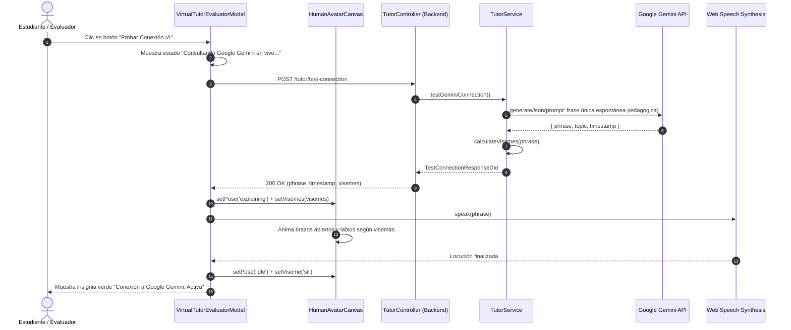
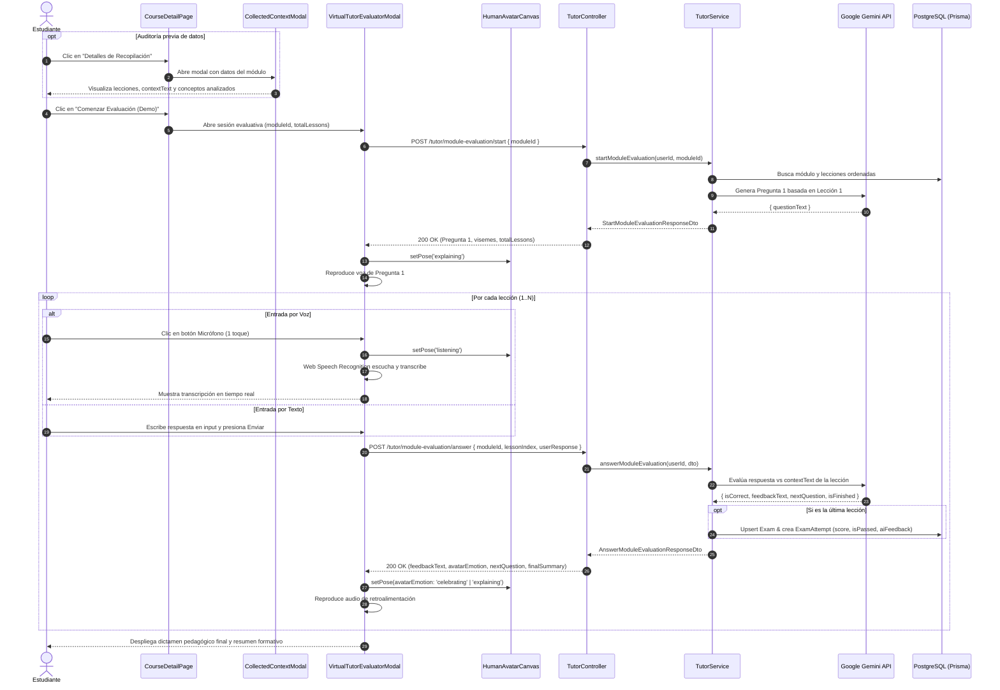

# Plan Técnico: Evaluación Interactiva con Docente Virtual Humanoide y Auditoría de Contexto

> Módulo: `docs/specs/02-docente-virtual-evaluacion/` | Especificación Base: `spec.md` | Estado: Diseñado | Metodología: SDD-Planning

---

## 1. Resumen Arquitectónico y Matriz de Componentes

### 1.1 Objetivo Técnico
Implementar la infraestructura completa de extremo a extremo para la evaluación interactiva del estudiante mediante un Docente Virtual humanoide 2.5D. Esto abarca:
1. Puntos de entrada en el temario del curso con auditoría de contexto y exención de créditos.
2. Un renderizador cinemático en HTML5 Canvas con articulación de brazos, parpadeo y visemas sincronizados.
3. El ciclo evaluativo de una pregunta por cada lección del módulo por voz o texto con persistencia en `ExamAttempt`.
4. Endpoint de verificación y diagnóstico en vivo con la API de Google Gemini.

### 1.2 Patrón Arquitectónico
- **Backend**: Arquitectura modular NestJS por capas (Controladores $\to$ Servicios de Aplicación $\to$ Acceso a Datos con Prisma ORM $\to$ Integración con Gemini AI).
- **Frontend**: Componentes modulares en React 18 con TypeScript estricto, Web Speech API para reconocimiento y síntesis de voz, y animación reactiva basada en `requestAnimationFrame` para la cinemática del avatar humano.

### 1.3 Matriz de Capas y Componentes

| Capa | Archivo / Componente | Responsabilidad |
| :--- | :--- | :--- |
| **Presentación (Web)** | `frontend-web/src/pages/CourseDetailPage.tsx` | Fila del Docente Virtual en cada módulo, botón de inicio (0 créditos) y disparador del modal de contexto. |
| **Presentación (Web)** | `frontend-web/src/components/CollectedContextModal.tsx` | Modal de auditoría que expone las lecciones, objetivos y textos (`contextText`) recopilados para la IA. |
| **Presentación (Web)** | `frontend-web/src/components/HumanAvatarCanvas.tsx` | Renderizador en Canvas 2.5D del docente humano (torso, brazos articulados en estados explicativo/escucha/aprobación, ojos y boca sincronizada). |
| **Presentación (Web)** | `frontend-web/src/components/VirtualTutorEvaluatorModal.tsx` | Vista modal/pantalla de la sesión evaluativa: botón de micrófono intuitivo, caja de texto, diálogo interactivo, botón "Probar Conexión IA" y resumen final. |
| **Dominio & Casos de Uso** | `backend/src/modules/tutor/tutor.service.ts` | Orquestación pedagógica: extracción de lecciones, llamadas estructuradas a Gemini, cálculo de visemas y posturas, persistencia de intentos. |
| **Controlador & HTTP** | `backend/src/modules/tutor/tutor.controller.ts` | Endpoints REST protegidos por JWT: prueba de conexión, inicio de evaluación y calificación de turnos. |
| **Infraestructura & Datos** | `backend/src/common/services/gemini.service.ts` | Cliente resiliente de Google Generative AI con rotación de modelos vigentes y timeouts fail-fast. |
| **Persistencia** | `backend/prisma/schema.prisma` (`Exam`, `ExamAttempt`) | Registro inmutable del resultado de la evaluación del módulo sin deducción de créditos en `CreditLedger`. |

---

## 2. Diagramas de Secuencia Técnicos

### 2.1 Flujo A: Diagnóstico en Vivo de Google Gemini ("Probar Conexión IA")



---

### 2.2 Flujo B: Ciclo de Evaluación Modular por Lecciones con Entrada por Voz/Texto



---

## 3. Contratos de Código e Interfaces Tipadas

### 3.1 Modelos de Dominio y Tipos Inmutables

```typescript
// frontend-web/src/types/tutor.types.ts

export type AvatarPoseType = 'idle' | 'explaining' | 'listening' | 'celebrating' | 'encouraging';

export type VisemeShape = 'sil' | 'aa' | 'E' | 'ih' | 'oh' | 'ou';

export interface VisemeFrame {
  timeMs: number;
  shape: VisemeShape;
  weight: number;
}

export interface CollectedLessonSummary {
  id: string;
  order: number;
  title: string;
  contextText: string;
}

export interface ModuleEvaluationContext {
  moduleId: string;
  moduleTitle: string;
  courseTitle: string;
  lessons: CollectedLessonSummary[];
}

export interface EvaluationTurnState {
  currentLessonIndex: number;
  totalLessons: number;
  lessonTitle: string;
  questionText: string;
  feedbackText?: string;
  isLastLesson: boolean;
}

export interface FinalEvaluationSummary {
  approved: boolean;
  scorePercentage: number;
  correctAnswersCount: number;
  totalQuestions: number;
  closingRemarks: string;
  attemptId?: string;
}
```

---

### 3.2 DTOs de Entrada y Salida (Backend NestJS)

```typescript
// backend/src/modules/tutor/dto/test-connection.dto.ts
import { IsOptional, IsBoolean } from 'class-validator';

export class TestConnectionDto {
  @IsOptional()
  @IsBoolean()
  demoMode?: boolean = true;
}

export interface TestConnectionResponseDto {
  success: boolean;
  provider: 'Google Gemini';
  modelUsed: string;
  phrase: string;
  timestamp: string;
  visemes: VisemeFrame[];
}

// backend/src/modules/tutor/dto/module-evaluation.dto.ts
import { IsNotEmpty, IsUUID, IsInt, Min, IsString } from 'class-validator';

export class StartModuleEvaluationDto {
  @IsNotEmpty()
  @IsUUID()
  moduleId: string;
}

export interface StartModuleEvaluationResponseDto {
  moduleId: string;
  moduleTitle: string;
  totalLessons: number;
  currentLessonIndex: number;
  currentLessonTitle: string;
  questionText: string;
  visemes: VisemeFrame[];
  collectedContext: {
    lessons: Array<{
      id: string;
      order: number;
      title: string;
      contextSummary: string;
    }>;
  };
}

export class AnswerModuleEvaluationDto {
  @IsNotEmpty()
  @IsUUID()
  moduleId: string;

  @IsInt()
  @Min(0)
  lessonIndex: number;

  @IsString()
  @IsNotEmpty()
  userResponse: string;
}

export interface AnswerModuleEvaluationResponseDto {
  isCorrect: boolean;
  feedbackText: string;
  visemes: VisemeFrame[];
  avatarEmotion: 'explaining' | 'listening' | 'celebrating' | 'encouraging';
  hasNextLesson: boolean;
  nextQuestion?: {
    lessonIndex: number;
    lessonTitle: string;
    questionText: string;
  };
  finalSummary?: {
    approved: boolean;
    scorePercentage: number;
    closingRemarks: string;
    attemptId?: string;
  };
}
```

---

### 3.3 Puertos de Interfaz de Servicios (Backend)

```typescript
// backend/src/modules/tutor/interfaces/tutor-service.interface.ts

export interface ITutorService {
  testGeminiConnection(): Promise<TestConnectionResponseDto>;
  
  startModuleEvaluation(
    userId: string,
    dto: StartModuleEvaluationDto,
  ): Promise<StartModuleEvaluationResponseDto>;

  answerModuleEvaluation(
    userId: string,
    dto: AnswerModuleEvaluationDto,
  ): Promise<AnswerModuleEvaluationResponseDto>;

  getModuleCollectedContext(
    moduleId: string,
  ): Promise<ModuleEvaluationContext>;
}
```

---

## 4. Garantías de Runtime, Persistencia e Integridad Relacional

### 4.1 Integridad del Grafo de Entidades y Claves Foráneas
- **Relaciones Prisma**:
  - `Module -> Exam`: Vinculado con `onDelete: Cascade`. Si un docente borra un módulo, las configuraciones evaluativas se limpian automáticamente.
  - `Exam -> ExamAttempt`: Vinculado con `onDelete: Cascade`.
  - `User -> ExamAttempt`: Vinculado con `onDelete: Restrict` según la Constitución (registros académicos inmutables).
- **Exoneración de Créditos**:
  - Los endpoints de `/tutor/module-evaluation/*` validan el JWT de autenticación del estudiante pero **no descuentan balance** en `CreditLedger`, garantizando acceso libre con balance cero ($0$ créditos) para la demostración.

### 4.2 Patrón de Selección Tridimensional (The 3-Way Selector Pattern)
1. **Selección Existente**:
   - Al iniciar la evaluación de un módulo, el servicio consulta si ya existe un `Exam` asociado a `moduleId`. Si existe, asocia el intento a ese registro.
2. **Creación en Caliente (*On-the-Fly*)**:
   - Si no existe un `Exam` registrado para el módulo, el servicio crea automáticamente en la base de datos el `Exam` modular (`title: "Evaluación con Docente Virtual - " + module.title`) en una transacción atómica sin interrumpir al estudiante.
3. **Estado Neutro / Zero-State Invariant**:
   - Si el módulo posee $0$ lecciones publicadas, el backend retorna una excepción controlada (`BadRequestException('El módulo seleccionado no posee lecciones para evaluar')`) y el frontend deshabilita el botón con la leyenda amigable: *"Sin lecciones publicadas para evaluar"*. Jamás se bloquea la interfaz.

### 4.3 Evolución del Esquema y Migraciones
- **Aprovechamiento de Esquema Vigente**:
  - Los modelos `Exam` y `ExamAttempt` ya poseen los campos requeridos (`moduleId`, `title`, `passScore`, `score`, `isPassed`, `aiFeedback`).
  - No se requieren migraciones destructivas ni alteración de claves existentes (`schemaVersion: 1.1`).

### 4.4 Resiliencia de I/O, Web Speech y Fallbacks
1. **Google Gemini API**:
   - Timeout preventivo estricto de 10 segundos implementado en `GeminiService`. Si la API de Google demora o se agota la cuota en Free Tier, se activa la respuesta heurística pedagógica determinista sin arrojar pantalla en blanco.
2. **Reconocimiento de Voz en Cliente**:
   - Detección de soporte para `webkitSpeechRecognition` o `SpeechRecognition`. Si el navegador no tiene soporte o el usuario deniega el permiso de micrófono, el sistema conmuta fluidamente al cuadro de entrada de texto mostrando un aviso contextual no bloqueante.

---

## 5. Diseño Cinemático del Avatar Humano 2.5D (`HumanAvatarCanvas.tsx`)

### 5.1 Anatomía y Elementos Visuales
El avatar humano se dibuja en un `<canvas>` de alta resolución ($400 \times 440\,\text{px}$) mediante trazado vectorial procedural con gradientes suaves y sombreado ergonómico:
1. **Torso y Vestimenta**:
   - Camisa/suéter profesional moderno con cuello en V, hombros definidos y postura erguida.
2. **Cabeza y Rasgos Faciales**:
   - Tono de piel cálido natural, cabello moderno con volumen y sombras.
   - Ojos expresivos con iris detallado, pestañas, cejas que se elevan al preguntar o sonreír, y ciclo de parpadeo periódico cada 3-4 segundos.
   - Boca con forma bezier y transición suave entre visemas (`sil`, `aa`, `E`, `ih`, `oh`, `ou`).
3. **Cinemática de Brazos y Manos Articulados**:
   - **Postura `'idle'`**: Brazos flexionados en reposo natural a la altura de la cintura.
   - **Postura `'explaining'`**: Brazos en ademán oratorio activo, mano derecha levantada con palma abierta haciendo movimientos suaves de balanceo al ritmo de la voz.
   - **Postura `'listening'`**: Brazo derecho flexionado llevando el índice/mentón en actitud de escucha atenta, cabeza ligeramente inclinada.
   - **Postura `'celebrating'`**: Ambos brazos en alto con pulgar arriba y sonrisa amplia al validar un acierto del estudiante.
   - **Postura `'encouraging'`**: Manos abiertas hacia el frente invitando a reflexionar de manera empática.

---

## 6. Estrategia de Testing y Validación Dual

### 6.1 Pruebas de Caja Blanca (Unit Tests)
- `backend/test/tutor.service.spec.ts`:
  - Verificación del cálculo temporal de visemas para textos en español.
  - Generación de posturas emocionales del avatar a partir de la evaluación de la respuesta.
  - Orquestación de turnos (lección $0 \to$ lección $1 \to \dots \to$ final).

### 6.2 Pruebas de Caja Negra (BDD / E2E Integration Tests)
- `backend/test/tutor.e2e-spec.ts`:
  - `POST /tutor/test-connection`: Retorna 200 OK con frase dinámica no vacía, timestamp y lista de visemas.
  - `POST /tutor/module-evaluation/start`: Retorna 200 OK con la primera pregunta y contexto recopilado de lecciones existentes.
  - `POST /tutor/module-evaluation/answer`: Procesa la respuesta de la lección, retorna retroalimentación con postura y persiste `ExamAttempt` con costo 0 créditos al completar el módulo.
