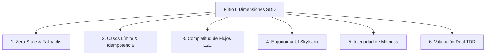
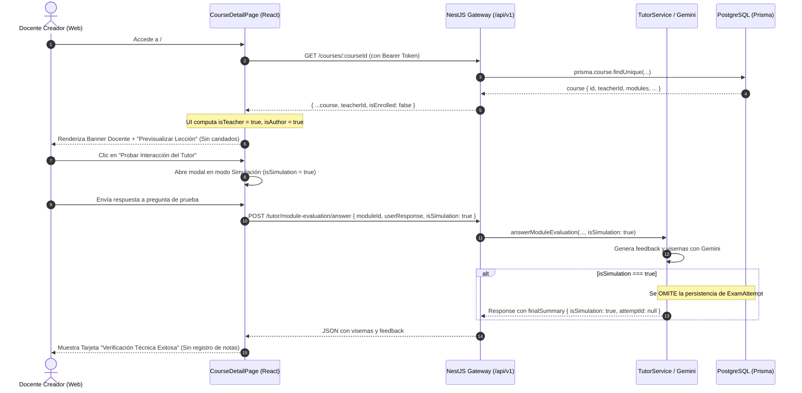
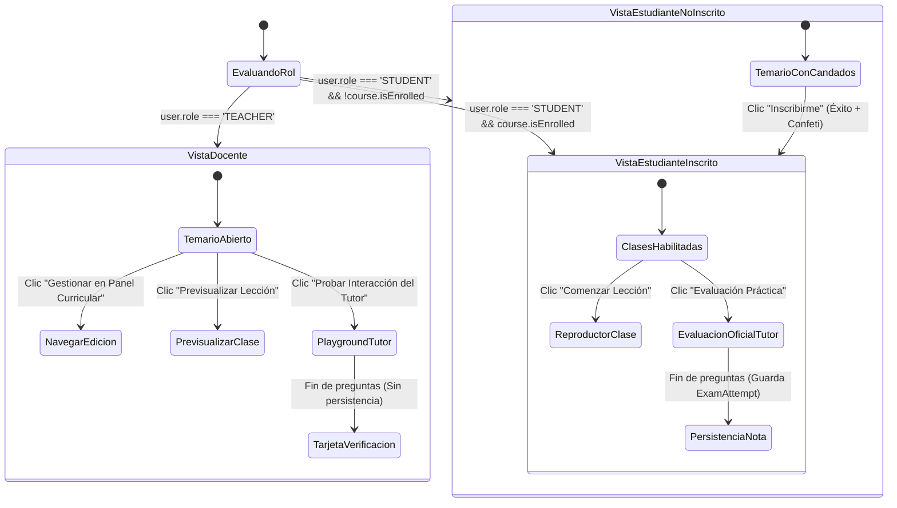

# Plan Técnico: Adaptación de Experiencia de Usuario (UX) por Rol en Temario y Tutor Virtual

> **Módulo:** `docs/specs/03-ux-temario-roles/`  
> **Especificación Base:** [spec.md](spec.md) (Estado: `APPROVED`)  
> **Estado:** APPROVED  
> **Metodología:** SDD-Planning & SDD-Spec-Assisted  
> **Fecha:** 2026-10-27  
> **Trazabilidad Constitucional:** [docs/constitution.md](../../constitution.md) (Secciones 1.2, 1.4, 2 y 4)

---

## 1. Auditoría de Cobertura SDD (6 Dimensiones de Inferencia Funcional)

Para garantizar un plan técnico resiliente y a prueba de fallos en runtime, se audita la especificación contra las 6 dimensiones funcionales:



1. **Estados Vacíos (Zero-State)**:
   - *Curso sin módulos/lecciones*: El estudiante visualiza una tarjeta de estado neutro informando "Curso en preparación pedagógica" con el botón de inscripción deshabilitado. El docente creador visualiza un CTA destacado "Crear Primer Módulo" con redirección inmediata a `#/teacher/courses/:id`.
   - *Módulo sin preguntas de evaluación*: Fallback heurístico en el Tutor Virtual que informa al docente de forma clara la necesidad de cargar contexto en las lecciones antes de evaluar.
2. **Casos Borde y Límites**:
   - *Docente no creador*: Si un docente visita el curso de otro profesor, visualiza el modo de previsualización sin botones de edición destructiva ni inscripción de estudiante.
   - *Doble clic e idempotencia en inscripción*: Desactivación reactiva del botón (`disabled={isEnrolling}`) y uso de `prisma.enrollment.upsert` en backend para prevenir duplicidad o carreras de concurrencia.
3. **Completitud y Simetría de Ciclos de Vida**:
   - Navegación bidireccional fluida: desde la vista pública del curso al gestor curricular (`#/teacher/courses/:id`) y viceversa.
   - Acceso directo del docente al reproductor de clases (`#/courses/:courseId/lessons/:lessonId`) sin exigir registros de matrícula.
4. **Ergonomía UI / Accesibilidad (Skylearn)**:
   - Erradicación absoluta de llamadas bloqueantes nativas (`window.alert`, `window.confirm`).
   - Implementación de banners y mensajes de notificación no intrusivos basados en tokens semánticos (Verde esmeralda para éxito `#046C4E`, rojo coral para errores `#E02424`).
5. **Aislamiento de Métricas e Integridad Relacional**:
   - La simulación del docente no descuenta créditos de balance freemium ni genera registros en `ExamAttempt` que alteren el cálculo del semáforo pedagógico móvil (tasa de aprobación y lecciones críticas en `frontend-mobile`).
6. **Validación Dual Obligatoria**:
   - Pruebas de caja blanca (unitarias/integración) sobre controllers, DTOs y lógica de aislamiento en backend y componentes React.
   - Pruebas de caja negra BDD verificando los 4 escenarios Gherkin formales estipulados en `spec.md`.

---

## 2. Resumen Arquitectónico por Proyecto

### 2.1 Backend (`backend/`)
- **Controlador y Servicio de Cursos (`courses/`)**:
  - `GET /courses/:id`: Expone de forma explícita `teacherId` y `isEnrolled` evaluado en base al `userId` del token JWT.
  - `POST /courses/:id/enroll`: Mantiene protección con Guards para rechazar o abortar amigablemente si el rol es `TEACHER`, emitiendo notificación push al docente creador solo ante matrículas de alumnos.
- **Controlador y Servicio del Tutor (`tutor/`)**:
  - `POST /tutor/module-evaluation/answer`: Admite la bandera opcional `isSimulation?: boolean`. Si `isSimulation === true` o el rol del usuario autenticado es `TEACHER`, se omite la creación de `prisma.examAttempt.create()`, devolviendo `attemptId: undefined` o identificador de simulación volátil, garantizando que los KPIs docentes no se modifiquen.

### 2.2 Frontend Web (`frontend-web/`)
- **Página de Detalle de Curso (`CourseDetailPage.tsx`)**:
  - Detección de rol y autoría:
    ```typescript
    const isTeacher = user?.role === 'TEACHER';
    const isAuthor = isTeacher && course?.teacherId === user?.id;
    ```
  - **Cabecera**:
    - Estudiante: CTA de inscripción con micro-animación y confeti al matricularse.
    - Docente: Banner de autoría/gestión con botón "Gestionar en Panel Curricular".
  - **Temario de Lecciones**:
    - Estudiante inscrito: Botón "Comenzar Lección" (`btn-primary`).
    - Estudiante no inscrito: Candado visual explicativo o CTA de inscripción contextual.
    - Docente: Botón "Previsualizar Lección" (`btn-secondary` con icono `Eye` o `PlayCircle`) con acceso directo a `onSelectLesson(lesson)`.
  - **Tutor Virtual al Cierre de Módulo**:
    - Estudiante: "Evaluación Práctica con Docente Virtual" (flujo formal).
    - Docente: "Probar Interacción del Tutor" (dispara modal en `isSimulation = true`, finalizando con tarjeta "Verificación Técnica Exitosa").
  - **Notificaciones**: Componente de banner o toast accesible en reemplazo de `alert()`.

### 2.3 Frontend Móvil (`frontend-mobile/`)
- **Inmunidad Analítica**:
  - Los endpoints de agregación de métricas (`/analytics/teacher/kpis` y `/analytics/courses/:id/health`) operan exclusivamente sobre exámenes completados por estudiantes (`user.role === 'STUDENT'`), blindados contra pruebas docentes.

---

## 3. Contratos de Datos e Interfaces TypeScript

### 3.1 DTOs del Backend (`backend/src/modules/tutor/dto/module-evaluation.dto.ts`)

```typescript
export class AnswerModuleEvaluationDto {
  @ApiProperty({ description: 'ID del módulo en evaluación', example: 'uuid-modulo' })
  @IsNotEmpty()
  @IsUUID()
  moduleId: string;

  @ApiProperty({ description: 'Índice de la lección evaluada (base 0)', example: 0 })
  @IsInt()
  @Min(0)
  lessonIndex: number;

  @ApiProperty({ description: 'Respuesta del usuario', example: 'Las variables almacenan valores en memoria.' })
  @IsString()
  @IsNotEmpty()
  userResponse: string;

  @ApiProperty({ description: 'Indica si la interacción es una prueba técnica de simulación docente', required: false, default: false })
  @IsOptional()
  @IsBoolean()
  isSimulation?: boolean;
}

export interface AnswerModuleEvaluationResponseDto {
  isCorrect: boolean;
  feedbackText: string;
  visemes: VisemeFrame[];
  avatarEmotion: AvatarEmotionType;
  hasNextLesson: boolean;
  isSimulation?: boolean;
  nextQuestion?: {
    lessonIndex: number;
    lessonTitle: string;
    questionText: string;
  };
  finalSummary?: {
    approved: boolean;
    scorePercentage: number;
    closingRemarks: string;
    attemptId?: string;
    isSimulation?: boolean;
  };
}
```

### 3.2 Interfaces Frontend (`frontend-web/src/pages/CourseDetailPage.tsx`)

```typescript
export interface CourseDetail {
  id: string;
  title: string;
  description: string;
  category: string;
  teacherName: string;
  teacherId?: string;
  isEnrolled: boolean;
  modules: Module[];
}

export interface UserSession {
  id: string;
  email: string;
  name: string;
  role: 'STUDENT' | 'TEACHER' | 'ADMIN';
}

export interface ToastNotification {
  type: 'success' | 'error' | 'info';
  message: string;
}
```

---

## 4. Diagramas Técnicos

### 4.1 Diagrama de Secuencia: Previsualización y Simulación del Docente



### 4.2 Diagrama de Estados: Ciclo de Vida de UI en Temario



---

## 5. Estrategia de Persistencia e Inmunidad Analítica

1. **Aislamiento de la Base de Datos**:
   - En `backend/src/modules/tutor/tutor.service.ts`:
     ```typescript
     const isSimulationMode = Boolean(dto.isSimulation || userRole === 'TEACHER');
     if (!hasNextLesson && !isSimulationMode && exam) {
       // Solo persiste si NO es simulación
       const attempt = await this.prisma.examAttempt.create({ ... });
       attemptId = attempt.id;
     }
     ```
2. **Idempotencia de Matrícula**:
   - El endpoint `courses.service.ts:enroll` utiliza `prisma.enrollment.upsert` asegurando atomicidad ante reintentos.
3. **Gestión de Estados Vacíos**:
   - Renderizado condicional en `CourseDetailPage.tsx`:
     ```tsx
     {course.modules.length === 0 ? (
       isAuthor ? (
         <div className="skylearn-card" style={styles.emptyStateBox}>
           <h3>Tu curso aún no tiene módulos</h3>
           <p>Comienza a estructurar el temario y agrega lecciones con video.</p>
           <button
             className="btn-primary"
             onClick={() => window.location.hash = `#/teacher/courses/${course.id}`}
           >
             Crear Primer Módulo
           </button>
         </div>
       ) : (
         <div className="skylearn-card" style={styles.emptyStateBox}>
           <h3>Curso en preparación pedagógica</h3>
           <p>El docente está preparando los contenidos interactivos. Vuelve pronto.</p>
         </div>
       )
     ) : ( /* mapeo de módulos */ )}
     ```

---

## 6. Desglose de Vertical Slices para Ejecución TDD

El plan se ejecutará en 3 Vertical Slices atómicos, testeables de extremo a extremo:

### Slice 1: Backend - Soporte de Simulación en Tutor y Protección de Métricas
- **Objetivo**: Permitir flag `isSimulation` en `POST /tutor/module-evaluation/answer`, omitiendo `ExamAttempt` y garantizando que el docente no ensucie analíticas.
- **Archivos**:
  - `backend/src/modules/tutor/dto/module-evaluation.dto.ts`
  - `backend/src/modules/tutor/tutor.service.ts`
  - `backend/src/modules/tutor/tutor.controller.ts`
  - `backend/test/tutor-simulation.e2e-spec.ts`

### Slice 2: Frontend Web - Cabecera Adaptativa, Temario Diferenciado y Cero `alert()`
- **Objetivo**: Transformar `CourseDetailPage.tsx` para adaptar cabecera por rol, desbloquear previsualización al docente, reemplazar `alert()` por toast accesible Skylearn y manejar cursos sin módulos.
- **Archivos**:
  - `frontend-web/src/pages/CourseDetailPage.tsx`

### Slice 3: Frontend Web - Modal de Simulación Docente (*Playground*) del Avatar
- **Objetivo**: Adaptar la apertura del modal evaluador del Tutor Virtual para docentes con indicador visual "Modo Simulación • Sin Calificación" y tarjeta de verificación técnica final.
- **Archivos**:
  - `frontend-web/src/pages/CourseDetailPage.tsx`

---

## 7. Estrategia de Verificación Dual (Dual Testing Gate)

| Nivel de Test | Tipo | Escenario / Archivo | Condición de Éxito |
| :--- | :--- | :--- | :--- |
| **Caja Blanca** | Unit / Integración | `tutor.service.spec.ts` | Al llamar a `answerModuleEvaluation` con `isSimulation: true`, `prisma.examAttempt.create` NO es invocado. |
| **Caja Blanca** | Unit / UI | `CourseDetailPage.spec.tsx` | Si `user.role === 'TEACHER'`, no existe botón "Inscribirme al Curso" y las lecciones muestran "Previsualizar Lección". |
| **Caja Negra (BDD)** | E2E | Escenario 1 Gherkin | Docente visita su curso, ve banner de autoría y accede a lección sin estar matriculado. |
| **Caja Negra (BDD)** | E2E | Escenario 2 Gherkin | Docente completa preguntas del tutor en modo simulación: avatar responde, pero base de datos no tiene nuevo `ExamAttempt`. |
| **Caja Negra (BDD)** | E2E | Escenario 3 Gherkin | Estudiante se inscribe: confeti se dispara, feedback visual sin `alert()`, temario se desbloquea en caliente. |
| **Caja Negra (BDD)** | E2E | Escenario 4 Gherkin | Curso sin módulos muestra tarjeta informativa accesible y bloquea inscripción a estudiantes. |
