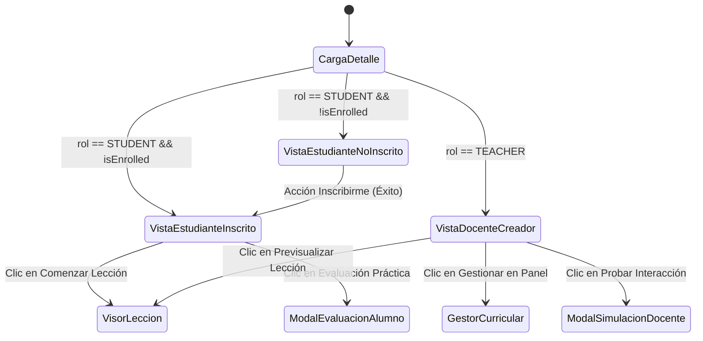

# Specification: Adaptación de Experiencia de Usuario (UX) por Rol en Temario y Tutor Virtual

> **Estado:** APPROVED  
> **Módulo:** 03-ux-temario-roles  
> **Metodología:** SDD-Spec-Assisted  
> **Fecha:** 2026-10-27  
> **Trazabilidad Constitucional:** [docs/constitution.md](../../constitution.md) (Secciones 1.2, 1.4, 2 y 4)

---

## 1. Objetivo y Alcance

### 1.1 Objetivo de Negocio
Eliminar la fricción cognitiva y la desalineación de roles en la vista de detalle de cursos y temarios curriculares, estableciendo una separación limpia y ergonómica estilo plataforma educativa moderna (Udemy):
1. **Para el Estudiante**: Una experiencia de descubrimiento, pre-inscripción transparente, retroalimentación accesible y progreso visible clase a clase.
2. **Para el Docente Creador**: Una experiencia libre de barreras de inscripción ficticias, con previsualización sin candados, navegación fluida a la edición curricular y un entorno de prueba (*Playground*) del Tutor Virtual para verificar el funcionamiento pedagógico de la IA sin adulterar las métricas analíticas de los alumnos.

### 1.2 In-Scope
- **Cabecera Adaptativa por Rol**:
  - Estudiante no inscrito: Llamada a la acción motivadora e inscripción en un clic.
  - Estudiante inscrito: Indicador de membresía activa y barra de progreso curricular.
  - Docente Creador: Banner de autoría/gestión con enlace directo a la edición curricular (`#/teacher/courses/:id`).
- **Temario Curricular y Acceso a Clases**:
  - Estudiante: Candado visual explicativo en clases bloqueadas y botón "Comenzar Lección" en clases habilitadas.
  - Docente: Desbloqueo total sin candados con botón "Previsualizar Lección".
- **Interacción con el Tutor Virtual al Cierre de Módulo**:
  - Estudiante: Evaluación formativa con calificación, feedback adaptativo y reporte de fortalezas/debilidades.
  - Docente: Modo de prueba técnica y simulación interactiva (*Playground*), con tarjeta de verificación técnica final y exclusión estricta de persistencia en historiales de notas.
- **Ergonomía y Micro-Feedback Skylearn**:
  - Sustitución de alertas emergentes nativas del navegador (`window.alert`) por componentes de notificación no intrusivos (*toasts* o banners).
  - Manejo de estados vacíos diferenciados según el rol ante cursos en preparación.

### 1.3 Out-of-Scope
- Creación de pasarelas de pago nuevas (se reutiliza la arquitectura Stripe establecida).
- Modificación del algoritmo matemático de visemas o del pipeline 3D en Three.js.
- Redirección forzosa de URL que impida al docente inspeccionar cómo luce su curso para el público general.

---

## 2. Actores y Matriz de Autorización

| Actor | Permiso en Cabecera | Permiso en Lecciones del Temario | Permiso en Tutor Virtual |
| :--- | :--- | :--- | :--- |
| **Estudiante Autenticado (`STUDENT`)** | Inscribirse si no lo está; ver su progreso si ya está inscrito. | Acceder solo a clases desbloqueadas o inscritas; candado en el resto. | Rendir evaluación formal calificada que consume créditos según plan. |
| **Docente Creador (`TEACHER`)** | Ver badge de Creador y botón de salto al panel curricular. | Previsualizar cualquier lección sin restricciones ni consumo de créditos. | Simular la interacción del avatar y preguntas sin registro de calificación ni alteración de KPIs. |
| **Visitante / No Inscrito** | Visualizar resumen público del curso e invitación a autenticarse. | Vista de solo lectura con candados en lecciones. | Bloqueado hasta iniciar sesión con rol correspondiente. |

---

## 3. Modelo Funcional y Reglas de Negocio

### 3.1 Datos Observables en la Interfaz
- `rolActivo`: Identificador del rol de usuario (`STUDENT` o `TEACHER`).
- `esCreadorDelCurso`: Booleano que indica si el docente activo es el autor del curso.
- `estadoInscripcionEstudiante`: Estado de afiliación (`NO_INSCRITO` o `INSCRITO`).
- `porcentajeAvanceCurso`: Ratio de lecciones completadas sobre el total de lecciones publicadas (0% a 100%).
- `modoEvaluacionTutor`: Modalidad de apertura del modal (`EVALUACION_ALUMNO` o `SIMULACION_DOCENTE`).

### 3.2 Reglas de Negocio (RB)

- **RB-01 (Inmunidad de Inscripción Docente)**: Un usuario con rol `TEACHER` jamás podrá ser sometido a un flujo de inscripción, pago o consumo de créditos para visualizar contenidos dentro de la plataforma.
- **RB-02 (Acceso Universal de Previsualización)**: Toda lección perteneciente a un módulo debe mostrarse en estado accesible para el docente creador, omitiendo estados de bloqueo o candados.
- **RB-03 (Aislamiento de Métricas del Docente Virtual)**: Cuando una sesión con el Tutor Virtual es iniciada por un docente, el sistema debe etiquetar la interacción como simulación volátil. Queda terminantemente prohibido registrar intentos en el historial del alumno o recalcular la tasa de aprobación del curso.
- **RB-04 (Degradación Elegante en Estados Vacíos)**:
  - Si un curso no posee lecciones publicadas:
    - Para el estudiante: Se inhabilita el botón de inscripción y se comunica claramente que el curso está "En preparación pedagógica".
    - Para el docente creador: Se exhibe un llamado a la acción con acceso directo al gestor curricular para cargar el primer módulo.
- **RB-05 (Ergonomía de Notificaciones)**: Queda prohibido el uso de diálogos bloqueantes del sistema operativo o navegador (`alert`, `confirm`). Todos los mensajes de éxito, advertencia o error de red deben desplegarse como micro-componentes visuales fluidos respetando la paleta accesible del sistema Skylearn.

---

## 4. Máquina de Estados de la Vista de Detalle



---

## 5. Requerimientos Funcionales (Sintaxis EARS)

### HU-01: Cabecera Adaptativa e Inteligente
- **RF-01.1 (Ubiquitous)**: El sistema deberá adaptar los elementos de llamada a la acción en la cabecera del curso en función del rol del usuario autenticado.
- **RF-01.2 (Event-Driven)**: Cuando un docente acceda a la vista de detalle de un curso, el sistema deberá ocultar todo formulario o botón de inscripción y mostrar en su lugar el botón de navegación hacia el gestor curricular.
- **RF-01.3 (Event-Driven)**: Cuando un estudiante no inscrito presione "Inscribirme al Curso", el sistema deberá registrar su membresía, emitir micro-feedback de confirmación visual y transicionar los botones del temario a estado activo sin requerir recargar la página.
- **RF-01.4 (Unwanted Behavior)**: Si un estudiante intenta inscribirse a un curso que no contiene lecciones publicadas, el sistema deberá deshabilitar la acción y mostrar el aviso "Curso en preparación pedagógica".

### HU-02: Temario Diferenciado y Previsualización Fluida
- **RF-02.1 (Ubiquitous)**: El sistema deberá presentar cada lección del temario con su respectivo botón de acción según los permisos del usuario activo.
- **RF-02.2 (Event-Driven)**: Cuando un docente visualice el listado de lecciones, el sistema deberá ofrecer el botón "Previsualizar Lección" con icono visual activo, permitiéndole ingresar al reproductor de clase inmediatamente.
- **RF-02.3 (Event-Driven)**: Cuando un estudiante inscrito visualice el temario, el sistema deberá exhibir una barra de progreso acumulado y badges que distingan las lecciones completadas de las pendientes.
- **RF-02.4 (Unwanted Behavior)**: Si un estudiante no inscrito pulsa sobre una lección con candado, el sistema deberá enfocar suavemente la llamada a la acción de inscripción con un mensaje instructivo contextual.

### HU-03: Tutor Virtual en Modo Simulación Docente (*Playground*)
- **RF-03.1 (Ubiquitous)**: El sistema deberá proveer una vía de prueba y verificación técnica del Tutor Virtual al cierre de cada módulo para el docente.
- **RF-03.2 (Event-Driven)**: Cuando el docente presione "Probar Interacción del Tutor", el sistema deberá abrir el entorno interactivo del avatar configurado en modo prueba volátil.
- **RF-03.3 (Event-Driven)**: Al concluir la sesión de prueba del docente, el sistema deberá presentar una tarjeta de "Verificación Técnica Exitosa" con el resumen de latencia y funcionamiento de preguntas, omitiendo el guardado de notas en la base de datos.
- **RF-03.4 (Unwanted Behavior)**: Si el servicio conversacional de inteligencia artificial experimenta degradación o error durante la prueba, el sistema deberá desplegar una alerta ergonómica en el diálogo ofreciendo reintento sin cerrar el avatar bruscamente.

---

## 6. Criterios de Aceptación y Comportamiento Observable (Gherkin BDD)

### Escenario 1: El docente creador visita su curso y previsualiza sin fricción (Happy Path Docente)
```gherkin
Given que el usuario ha iniciado sesión con el rol "TEACHER"
And se encuentra en la vista de detalle de un curso de su autoría
When la página finaliza la carga de datos
Then el sistema no muestra ningún botón de "Inscribirme al Curso" ni mensajes de créditos
And muestra un banner de creador con el botón "Gestionar en Panel Curricular"
And cada lección del temario presenta el botón activo "Previsualizar Lección" sin iconos de candado
```

### Escenario 2: El docente prueba el funcionamiento del Tutor Virtual en modo simulación (Happy Path Playground)
```gherkin
Given que el docente se encuentra en el temario de un módulo con lecciones
When presiona el botón "Probar Interacción del Tutor"
Then el sistema abre el modal con el avatar interactivo rotulado como "Modo Simulación • Sin Calificación"
And permite enviar respuestas por voz o texto a las preguntas formuladas por la IA
And al responder la última pregunta muestra la tarjeta "Verificación Técnica Exitosa"
And no descuenta créditos ni registra ningún intento en el historial de evaluaciones de alumnos
```

### Escenario 3: Estudiante se inscribe con micro-feedback inmediato (Happy Path Estudiante)
```gherkin
Given que un estudiante autenticado visita un curso con lecciones y no está inscrito
When presiona el botón "Inscribirme al Curso"
Then el sistema procesa la inscripción exitosamente
And muestra una animación de confeti y una notificación visual accesible sin usar alertas del navegador
And el botón de la cabecera se transforma en "Estás inscrito en este curso"
And todas las lecciones del temario habilitan inmediatamente el botón "Comenzar Lección"
```

### Escenario 4: Curso vacío en preparación pedagógica (Caso Borde)
```gherkin
Given que un curso recién creado no posee módulos ni lecciones cargadas
When un estudiante accede a la vista de detalle
Then el sistema deshabilita el botón de inscripción
And muestra una tarjeta ilustrativa informando "Curso en preparación pedagógica"
When un docente accede a ese mismo curso
Then el sistema muestra el botón destacado "Crear Primer Módulo" que redirige al gestor curricular
```

---

## 7. Efectos Secundarios e Integraciones

1. **Integración con Gestor Curricular (`TeacherCourseManager`)**:
   - El botón de gestión del docente navega a `#/teacher/courses/:id` preservando el estado de navegación en el historial.
2. **Integración con Notificaciones Docente en Móvil**:
   - Cuando un estudiante completa su inscripción mediante el botón adaptativo, el backend emite la notificación push correspondiente al docente del curso en la aplicación móvil Expo.
3. **Integración con Analítica Docente**:
   - Las pruebas ejecutadas por el docente bajo el modo simulación no alteran el porcentaje general de aprobación del curso ni impactan en el semáforo pedagógico móvil.
